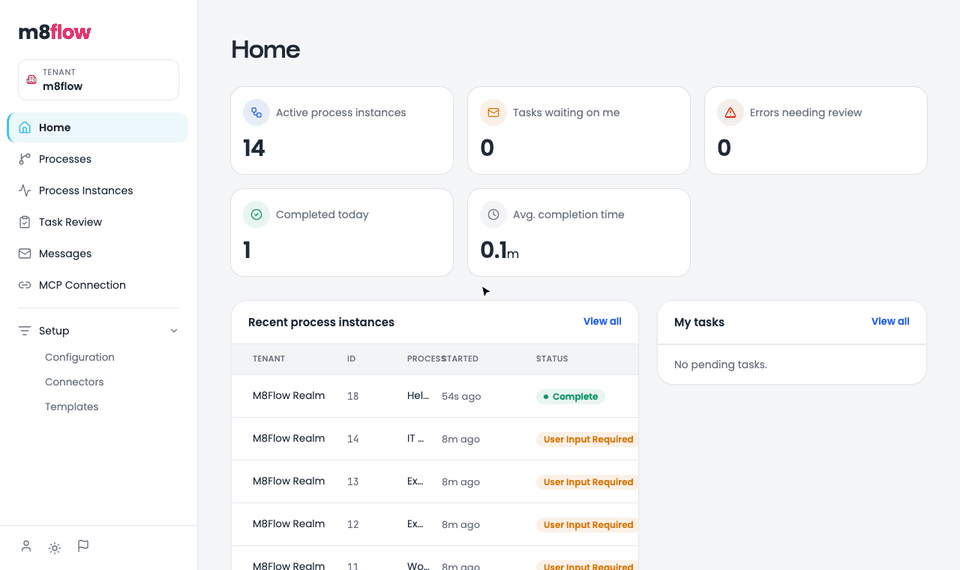

<p align="center">
  
</p>

<p align="center">
  <strong>Open-source, multi-tenant BPMN workflow automation in Python.</strong><br>
  Model processes visually, run them on a Python engine, put people and systems in the loop,
  and keep every tenant's work apart.
</p>

<p align="center">
  <a href="https://github.com/AOT-Technologies/m8flow/actions/workflows/backend-cicd.yaml"></a>
  <a href="https://github.com/AOT-Technologies/m8flow/actions/workflows/designer-cicd.yaml"></a>
  <a href="https://github.com/AOT-Technologies/m8flow/actions/workflows/codeql.yml"></a>
  <a href="https://github.com/AOT-Technologies/m8flow/releases"></a>
  <a href="LICENSE"></a>
  <a href="https://reuse.software/"></a>
</p>

# m8flow

m8flow is a workflow platform for teams that automate business processes:
approvals, onboarding, case handling, and integrations between systems. You
draw a process in BPMN 2.0, attach forms and decision tables, publish it, and
m8flow runs it. People complete their steps in a web inbox, systems join
through connectors and API triggers, and AI assistants can drive it through
the Model Context Protocol (MCP).

One deployment serves many organizations. Each tenant has its own catalog,
running processes, tasks, secrets, and members, isolated down to the database
row, with roles that decide who can design, run, review, or only watch.

<p align="center">
  
</p>

## See it in action

The designer is where processes are modeled, run, and worked. The following
recording shows Home, the process catalog, the BPMN modeler, a live process
instance, and the template gallery. The [product tour](docs/tour.md) covers every
page, with screenshots.

<p align="center">
  
</p>

## The 8 principles

m8flow's vision is shaped by **8 guiding principles** for flow orchestration.
The "m8" in the name stands for them:

- **Merge flows effectively** – streamline complex workflows
- **Make apps faster** – speed up development and deployment
- **Manage processes better** – bring structure and clarity to execution
- **Minimize errors** – reduce mistakes through automation
- **Maximize efficiency** – get more done with fewer resources
- **Model workflows visually** – design with simplicity and clarity
- **Modernize systems** – upgrade legacy processes seamlessly
- **Mobilize innovation** – empower teams to build and experiment quickly

## Features

### Model

- **BPMN 2.0 modeler** in the browser, with a properties panel for tasks,
  lanes, timers, gateways, subprocesses, and events.
- **DMN decision tables** that business rule tasks evaluate at run time.
- **Forms from JSON Schema.** A user task binds to a form schema, an optional
  UI schema, and example data, edited next to the diagram.
- **Templates.** Start from a versioned template, save any process model as
  one, and share it with yourself, your tenant, or every tenant. m8flow ships
  seven sample templates, from a single approval to Salesforce-to-Slack and
  PostgreSQL automation.
- **Tests.** Run BPMN unit tests and script-task unit tests from the process
  model page.
- **Lifecycle.** Process models move between draft, published, and paused, so
  nothing starts before it's ready.

### Run

- **Process instances** you can follow live: a diagram with task states, open
  tasks and who they wait for, completed tasks, and an event history.
- **Suspend, resume, and terminate** a running instance.
- **Task inbox.** **Home** shows your tasks, and **Task Review** lists the work
  waiting for your review, with the approval chain and activity.
- **Lane-based assignment.** A BPMN lane maps to a group, so the right people
  see the task.
- **Timers** that a background scheduler fires, per tenant.
- **External forms.** A user task can send a secure, expiring link by email,
  so someone outside m8flow can complete a form.

### Integrate

- **Connectors** for HTTP, SMTP, Slack, Salesforce, Stripe, GitHub, n8n, and
  PostgreSQL, run through a separate connector proxy.
- **Connector profiles** that hold credentials per tenant, selected by name in
  a service task.
- **Secrets** stored encrypted (or in HashiCorp Vault) and referenced in BPMN
  as `M8FLOW_SECRET:<key>`, never as plain text.
- **API keys and event triggers.** External systems start processes over HTTP
  with a scoped tenant key, delivered through NATS JetStream.
- **AI assistants.** The m8flow MCP server lets Claude, Cursor, and other MCP
  clients list, create, and start processes, and the **MCP Tools** page runs
  those tools from the browser.
- **REST API** with an OpenAPI 3 spec and an interactive reference.

### Govern

- **Multi-tenancy** with Keycloak organizations as tenants and PostgreSQL
  row-level security under every query.
- **Seven roles**, from `super-admin` and `tenant-admin` to `editor`,
  `integrator`, `reviewer`, `submitter`, and `viewer`.
- **Tenant administration**: members, groups, role grants, and email
  invitations.
- **Permission-aware UI.** The designer shows only the actions the backend
  allows you to take.
- **Pluggable identity.** Keycloak is built in, behind an auth-provider seam
  for other OpenID Connect providers.

### Operate

- **One Docker Compose stack** for local use, with optional NATS and
  observability stacks.
- **Observability**: OpenTelemetry logs, metrics, and traces, with Grafana
  dashboards for application health, SQL, and NATS.
- **Health and readiness endpoints** for load balancers.
- **Nine languages** in the designer: English, German, Spanish, French,
  Portuguese (Brazil and Portugal), Finnish, Czech, and Simplified Chinese.

## Quick start

You need [Git](https://git-scm.com/downloads) and
[Docker](https://www.docker.com/products/docker-desktop/) with Compose v2. To
start m8flow with its first-run setup, run the following commands:

```bash
git clone https://github.com/AOT-Technologies/m8flow.git
cd m8flow
cp sample.env .env
docker compose --env-file .env --profile init \
    -f docker/m8flow-docker-compose.yml up -d --build
```

Open the designer at [localhost:6853](http://localhost:6853/) and sign in as
`editor` with the password `editor`. Keycloak asks you to choose a new password
the first time. The [quick start tutorial](docs/tutorials/quick-start.md) takes you
from there to a running process.

## Documentation

The full documentation lives in [`docs/`](docs/). The pages follow the
[Diátaxis](https://diataxis.fr/) structure: tutorials to learn, how-to guides
for one task, explanations for the why, and reference for exact values.

| I want to… | Read |
|---|---|
| See what the designer can do | [Product tour](docs/tour.md) |
| Run m8flow and build my first process | [Quick start](docs/tutorials/quick-start.md) |
| Hack on the backend or the designer | [Run from source](docs/how-to/run-from-source.md) · [Develop and test](docs/how-to/develop-and-test.md) |
| Add tenants, members, and roles | [Manage tenants and members](docs/how-to/manage-tenants-and-members.md) · [Roles and permissions](docs/reference/roles-and-permissions.md) |
| Call an API or send email from a process | [Call external services](docs/how-to/call-external-services.md) |
| Start processes from another system | [Trigger processes with API keys](docs/how-to/trigger-processes-with-api-keys.md) |
| Connect an AI assistant | [Set up MCP tools](docs/how-to/set-up-mcp-tools.md) |
| Watch logs, metrics, and traces | [Enable observability](docs/how-to/enable-observability.md) |
| Understand how it fits together | [Architecture](docs/explanation/architecture.md) · [Multi-tenancy and access](docs/explanation/multi-tenancy-and-access.md) · [Process execution](docs/explanation/process-execution.md) |
| Plug in another identity provider | [Auth provider](docs/auth-provider/README.md) |
| Look up a port, variable, or endpoint | [Services and ports](docs/reference/services-and-ports.md) · [Configuration](docs/reference/configuration.md) · [HTTP API](docs/reference/http-api.md) |
| Check which BPMN elements work | [BPMN support](docs/reference/bpmn-support.md) |
| Find my way around the code | [Repository layout](docs/reference/repository-layout.md) |

The product vocabulary (process model, process instance, catalog, active
tenant, and so on) is defined in the glossary,
[`CONTEXT.md`](CONTEXT.md).

## How it's built

m8flow is a set of services around one Python backend:

- **`m8flow-backend`** is the HTTP host. It runs the `m8flow-bpmn-core` engine
  in process and owns sign-in, tenancy, permissions, secrets, and scheduling.
- **`m8flow-designer`** is the web UI, built with Vite, React, and TypeScript.
- **Keycloak** handles identity, **PostgreSQL** stores state, and **Redis**
  feeds the **Celery** workers that fire timers.
- **`m8flow-node-wire-proxy`** runs connector calls, and the optional
  **NATS** consumer and **MCP** server add event triggers and AI access.

[About the m8flow architecture](docs/explanation/architecture.md) walks through
the components and the path of a request.

## Get help and contribute

- Read [SUPPORT.md](SUPPORT.md) for where to ask questions, and
  [Troubleshoot m8flow](docs/how-to/troubleshoot.md) for common problems.
- Report bugs and request features in the
  [issue tracker](https://github.com/AOT-Technologies/m8flow/issues).
- Report security vulnerabilities privately, as described in
  [SECURITY.md](SECURITY.md). Don't open a public issue.
- Before you open a pull request, read the [contributing guide](CONTRIBUTING.md).
- Everyone who takes part follows the [code of conduct](CODE_OF_CONDUCT.md).
  [GOVERNANCE.md](GOVERNANCE.md) explains how decisions are made.
- Release notes are in the [changelog](CHANGELOG.md) and on the
  [releases page](https://github.com/AOT-Technologies/m8flow/releases). The
  [versioning policy](docs/reference/versioning.md) explains what a version
  number promises.

## License

m8flow is released under the [Apache License 2.0](LICENSE). See
[NOTICE](NOTICE) for third-party attributions and
[DEPENDENCIES.md](DEPENDENCIES.md) for the license of every dependency.
