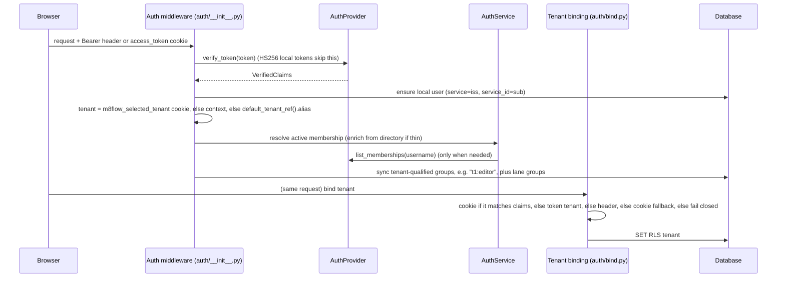
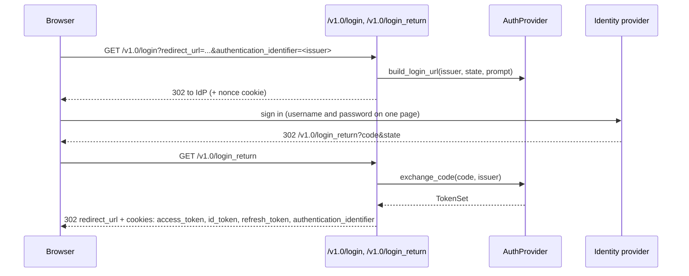

# How the auth provider works

Paths are relative to `m8flow-backend/src/m8flow_backend/` unless marked otherwise.

## The three layers

The auth code has three layers, each calling only the one beneath it:

<p align="center">
  
</p>

- **The provider** knows the IdP: its URLs, its token shape, and its admin API.
  It translates everything into neutral types.
- **`AuthService`** owns every multi-step flow, written once against the
  provider interface. It is stateless and cheap: build one per use with
  `AuthService(get_auth_provider())`.
- **The host** owns everything that touches cookies, the database, row-level
  security, or HTTP responses.

## The provider contract

`AuthProvider` (`integrations/auth/base/provider.py`) is an abstract class.

### Required methods

| Group | Methods | Purpose |
|---|---|---|
| Session (OIDC) | `build_login_url`, `exchange_code`, `refresh`, `build_logout_url` | Browser login and logout, token grants. Every call takes an opaque `IssuerRef` (Keycloak: a realm name). |
| Verification | `verify_token(token) -> VerifiedClaims` | Verify signature, issuer, audience and expiry, then map claims. |
| Directory reads | `get_user`, `search_users`, `list_memberships(username)` | `list_memberships` is the source of truth when a token's membership list is thin. |
| Active tenant | `set_active_tenant`, `clear_active_tenant` | Server-side "active tenant" state for providers that switch by re-minting the token. |
| Self-description | `default_issuer`, `default_tenant_ref`, `authorization_endpoint_url`, `default_issuer_claim` | The login entry point and the default tenant. |

### Optional, with safe defaults

| Member | Default | Meaning |
|---|---|---|
| `is_master_issuer(claims)` | `False` | Did the token come from the platform/bootstrap issuer? |
| `switch_mode` | `SwitchMode.REMINT` | How a token comes to carry a different tenant (see [Switch modes](#switch-modes)). |
| `trust_domain(claims)` | `PLATFORM` if `is_master_issuer`, else `SHARED` | The kind of issuer: platform, shared (many tenants), or tenant (one tenant). |
| `user_admin`, `tenant_admin`, `group_admin`, `role_admin`, `directory_admin`, `provisioning` | raise `CapabilityNotSupported` | Admin features the IdP supports. The tenant-management UI uses them. |

`OidcAuthProvider` (`base/oidc.py`) implements the session and verification
methods for any spec-compliant IdP. A subclass supplies an `OidcClient` (URLs,
issuer and audience rules, client authentication) and implements
`map_claims(payload)`. The [provider guide](./writing-a-provider.md) walks
through this.

### Neutral types (`base/models.py`)

Providers translate vendor claims into these types:

```python
TenantRef(id: str | None, alias: str | None, name: str | None)

Membership(
    tenant_ref: TenantRef,
    roles: list[str],              # neutral role names, e.g. "editor"
    groups: list[str],             # directory group leaf names, e.g. "Designers" (BPMN lanes)
    roles_complete: bool = False,  # issuer asserts roles+groups are complete for this tenant
)

VerifiedClaims(
    subject: str, issuer: str,
    username: str | None, email: str | None,
    roles: list[str],                          # top-level roles; "super-admin" lives here
    memberships: list[Membership],
    active_tenant_ref: TenantRef | None,       # the tenant the token was minted for (a hint)
    jwt_claims: dict,                          # verified payload, debug only
    issuer_key: str | None = None,             # opaque routing key (Keycloak: realm name)
    trust_domain: TrustDomain | None = None,   # PLATFORM | SHARED | TENANT
    memberships_complete: bool = False,        # memberships lists every tenant the user has
)
```

Neutral tenant roles (`base/roles.py`) are `tenant-admin`, `editor`,
`integrator`, `reviewer`, `submitter` and `viewer`. The platform role is
`super-admin`.

## Request lifecycle

Every request that carries a token goes through the same steps:



### Verification

`auth.decode_auth_token` looks at the token header:

- **HS256** tokens are m8flow's own local tokens (test logins), verified with
  `FLASK_SESSION_SECRET_KEY`.
- **Any other algorithm** goes to `get_auth_provider().verify_token()`. The
  result is stored on `g.verified_claims`.

Only the typed `VerifiedClaims` fields may drive authorization. `jwt_claims` is
kept for debugging.

### Local user provisioning

The middleware finds or creates the local `UserModel`, keyed on
`(service = iss, service_id = sub)`. The user's tenant comes from the
`m8flow_selected_tenant` cookie, then the request's tenant context, then the
provider's `default_tenant_ref().alias`.

### Membership authority and group sync

`sync_groups_from_token` asks `resolve.select(...)` which membership is active
for the chosen tenant. The rule lives in `integrations/auth/core/membership.py`:

1. Match a token membership to the tenant by id, alias, name or canonical
   tenant row.
2. Decide whether it needs enrichment:
   - no token memberships at all: no enrichment;
   - no membership for this tenant: enrich;
   - lanes are needed and the membership has no `groups`: enrich (request-time
     sync always needs lanes);
   - the membership has neither roles nor groups, and is not `roles_complete`:
     enrich.
3. To enrich, call the provider's `list_memberships(username)` through
   `ProviderDirectory` and take that tenant's entry. If the directory fails,
   keep the token's membership (best effort).
4. Map neutral roles to tenant-qualified groups (`<tenant-id>:<role>`), add
   `super-admin` if it is in the top-level `roles`, and map `groups` to BPMN
   lane groups.

Keycloak's mapper emits the active organization **without groups**, so step 2
usually triggers a directory call on each request. Set
`M8FLOW_AUTH_MEMBERSHIP_CACHE_TTL_SECONDS` to cache those calls (see
[Identity provider prerequisites](./prerequisites.md#opt-in-switches)).

### Tenant binding

`auth/bind.py::resolve_request_tenant` picks the request's tenant, in this order:

1. A super-admin `tenantId` override, or the super-admin's selected-tenant cookie.
2. The `m8flow_selected_tenant` cookie, when the user's claims include that tenant.
3. The token's active tenant (`active_tenant_ref`, or the `M8FLOW_TENANT_CLAIM`
   claim, default `m8flow_tenant_id`).
4. The `x-m8flow-tenant-id` header, if the user belongs to that tenant.
5. The cookie again, if the local user belongs to that tenant.
6. Otherwise authenticated non-exempt routes fail closed with `tenant_required`.

Platform sessions (`AuthService.is_platform_session`, which is
`trust_domain == PLATFORM`) are treated like tenant-exempt requests
(`is_tenant_context_exempt_request`): tenant-scoped queries return the global
view instead of failing for a user who legitimately has no tenant.

## Login

The following sequence shows a browser login:



`authentication_identifier` is the `IssuerRef` value (for Keycloak, a realm
name). When it is absent, `default_issuer()` is used. The frontend sends the
master realm name for "platform admin sign in".

`POST /v1.0/refresh` uses the `refresh_token` cookie and `provider.refresh()`.

## Tenant finalization and switching

After login, or when the user picks another tenant, the designer navigates to:

```text
GET /v1.0/login?tenant=<alias>&tenant_finalization=1&redirect_url=...
```

`auth.try_finalize_shared_realm_session` then:

1. Re-verifies the current session token. If that fails, it falls back to a
   normal login.
2. Looks up the tenant row (404 `tenant_not_found` if missing).
3. Gets the user's memberships fresh from the directory
   (`AuthService.directory_memberships_best_effort`, never cached), falling back
   to the token's.
4. Requires a membership for that tenant (403 `tenant_not_available`).
5. Provisions the local user and syncs groups for that tenant.
6. Calls `AuthService.switch_tenant(...)` (see [Switch modes](#switch-modes)).
7. Redirects. It sets new token cookies if the token was re-minted, and
   **always** sets `m8flow_selected_tenant`.

## Switch modes

The provider declares `switch_mode`; `AuthService.switch_tenant` runs the flow.

| Mode | Used by | What happens | Status |
|---|---|---|---|
| `REMINT` | Keycloak Organizations | `set_active_tenant` writes server-side state (Keycloak: the `m8flow_active_tenant` user attribute), then `refresh` re-mints a token carrying the new tenant. Any provider error degrades to "cookie switched, token catches up later". | Wired |
| `COOKIE_ONLY` | Tokens that are not tenant-bound | Only the cookie changes. | Wired |
| `REAUTHORIZE` | Auth0 Organizations | A new authorize request with `organization=...`, silent if the IdP session is alive. | Declared; raises `CapabilityNotSupported` until the host handles the redirect |
| `REAUTHENTICATE` | Keycloak realm-per-tenant | Log in at the target tenant's own issuer. | Declared; raises `CapabilityNotSupported` until the host handles the redirect |

## Logout

`GET /v1.0/logout` builds the IdP logout URL (`build_logout_url`) and clears
the session cookies and `m8flow_selected_tenant`. It then calls
`AuthService.end_session(username)` (best effort), which for `REMINT`
providers clears the server-side active tenant, so the next login does not
silently resume the previous tenant.

## Neutral session view

`GET /v1.0/m8flow/session` (authenticated, tenant-exempt) returns the session
in provider-neutral terms, so a frontend does not have to decode vendor JWTs:

```json
{
  "subject": "8d6c...", "username": "editor", "email": "editor@example.com",
  "trust_domain": "shared", "is_platform_session": false,
  "selected_tenant": "a787d38c-...",
  "token_active_tenant": {"id": "a787d38c-...", "alias": "org1", "name": "Org 1"},
  "switch_mode": "remint",
  "capabilities": {"user_admin": true, "tenant_admin": true, "group_admin": true,
                   "role_admin": true, "directory_admin": true, "provisioning": true}
}
```

The tenant switcher's list of tenants still comes from
`GET /v1.0/m8flow/organization-memberships` (`AuthService.memberships_for_switcher`).

## Related pages

- [JWT token shape](./jwt-token-shape.md)
- [Write an auth provider](./writing-a-provider.md)
- [About multi-tenancy and access control](../explanation/multi-tenancy-and-access.md)
