# About the m8flow architecture

m8flow is a host application built around a separate BPMN engine package.
The engine, `m8flow-bpmn-core`, parses BPMN and DMN, runs process instances,
and stores engine state. The host, `m8flow-backend`, adds everything a
multi-tenant product needs on top: HTTP routes, sign-in, tenant isolation,
permissions, secrets, scheduling, and connectors.

## Components

A default Compose stack runs the following components:

| Component | Role |
|---|---|
| `m8flow-designer` | Web UI. An nginx container serves the Vite and React app and forwards `/v1.0` to the backend on the same origin. |
| `m8flow-backend` | HTTP host. Connexion 3 and Flask, served as an ASGI app. Runs the engine in process. |
| `m8flow-bpmn-core` | Engine wheel, installed into the backend. Not a separate service. |
| `m8flow-celery-worker` | Celery worker for background jobs, including the scheduler task that runs due timers. |
| `m8flow-celery-flower` | Celery monitoring UI. |
| `m8flow-node-wire-proxy` | Runs HTTP service-task requests for the backend. |
| `m8flow-notification-worker` | Emails external-form links. Also subscribes to NATS when NATS is on. |
| `keycloak` and `keycloak-proxy` | Identity provider. Tokens carry the m8flow tenant claims. |
| `m8flow-db` | PostgreSQL for m8flow and engine data, with row-level security per tenant. |
| `redis` | Celery broker and result backend. |
| `minio` | Object storage. The `init` jobs sync the seed process models and templates into it. |

Optional components start from extra Compose files or profiles: the NATS
server and `m8flow-nats-consumer` for event triggers, the Grafana observability
stack, and the `m8flow-mcp` Model Context Protocol (MCP) server for AI assistants.

The following figure shows how the components connect:

  

For ports and Compose profiles, see
[Services and ports](../reference/services-and-ports.md).

## Host and engine

The host calls the engine only through the public `m8flow_bpmn_core` API, and
only from host modules. It never imports the engine's internal libraries.
This boundary keeps engine upgrades to a version bump of one wheel, with a
migration note for breaking releases.

The backend groups its behavior into eight host modules under
`m8flow-backend/src/m8flow_backend/`:

| Module | Owns |
|---|---|
| `workflow` | Starting, advancing, suspending, resuming, and terminating process instances. Every engine write goes through this module. |
| `catalog` | Process groups, process models, and their files on disk, per tenant. Rejects BPMN constructs the engine doesn't support. |
| `human_task` | Human tasks: candidates, claim, forms, draft data, and completion. |
| `scheduler` | Timer jobs. Runs due jobs once per active tenant. |
| `identity` | Tenants, users, groups, and memberships. |
| `auth` | Token verification, local user records, and binding each request to a tenant. |
| `authorization` | The permission policy and the `permissions-check` answers the designer uses. |
| `secrets` | Tenant secrets, and replacing `M8FLOW_SECRET:<key>` sentinels at run time. |

Routes in `m8flow_backend/routes/` stay thin. They read the request, call a
host module, and shape the response. Routes don't run engine commands or write
identity tables themselves.

## Request path

Every API request passes through the same layers, in this order:

1. **Designer.** The browser calls `/v1.0/...` on the designer origin, and the
   designer's nginx forwards the call to the backend.
2. **Auth middleware.** The backend reads the bearer token or the
   `access_token` cookie, verifies it with the auth provider, and finds or
   creates the local user.
3. **Tenant binding.** The backend picks the active tenant from the
   `m8flow_selected_tenant` cookie and the token claims, then sets the
   PostgreSQL tenant for the request's database session.
4. **Authorization.** The backend checks the user's groups against the
   permission policy for the route's URI and HTTP method.
5. **Host module.** The route calls a host module, which calls the engine when
   it needs to.
6. **Commit.** The request's database session commits when the response is a
   success. Any 4xx or 5xx response rolls the session back, so a failed request
   never leaves half-finished engine state.

  

[Multi-tenancy and access control](multi-tenancy-and-access.md) explains steps
2 to 4 in detail.

## Storage

m8flow keeps data in three places:

- **PostgreSQL** holds process instances, tasks, events, users, groups,
  permissions, tenants, secrets, and audit records. Tenant-scoped tables carry
  an `m8f_tenant_id` column.
- **The process-model directory** holds the catalog as files, one folder per
  tenant, under `M8FLOW_BACKEND_BPMN_SPEC_ABSOLUTE_DIR`. Compose bind-mounts
  `data/process_models` from the repository.
- **The templates directory** holds template versions as files, under
  `M8FLOW_TEMPLATES_STORAGE_DIR`.

## Design rules

The following rules keep the architecture stable. Code review enforces them:

- No imports of the engine's internal libraries (`spiffworkflow`,
  `spiffworkflow_backend`) in `m8flow-backend`.
- No engine commands or scheduler runs called from routes.
- No direct inserts into user, group, permission, or tenant tables from
  routes.
- No patches to engine internals. New behavior goes into a host module.

## Next steps

- [Read how tenants and permissions work](multi-tenancy-and-access.md).
- [Read how a process instance runs](process-execution.md).
- [See where each part lives in the repository](../reference/repository-layout.md).
