# About multi-tenancy and access control

One m8flow deployment serves many tenants. Each tenant has its own catalog,
process instances, tasks, secrets, and members, and no tenant can read
another tenant's rows. Three mechanisms enforce this together: Keycloak
organizations decide who belongs to which tenant, the active-tenant cookie
decides which tenant a request works in, and PostgreSQL row-level security
(RLS) filters every query to that tenant.

## Realms and tenants

m8flow uses two Keycloak realms:

- **The shared realm** (`m8flow` by default) is where tenant users sign in.
  Each Keycloak organization in this realm is one m8flow tenant. A user can
  belong to more than one organization.
- **The master realm** is for platform administrators. The `super-admin` user
  signs in here, through the **Platform Admin Sign In** link on the shared-realm
  sign-in page.

The Keycloak image includes the m8flow realm-info-mapper extension, so tokens
carry the `m8flow_tenant_id` and `m8flow_tenant_name` claims for the tenant the
token was minted for.

## Sign-in and tenant selection

Sign-in is a browser redirect flow that the backend drives. The designer
doesn't talk to Keycloak directly:

1. The designer sends the browser to `GET /v1.0/login` on the backend.
2. The backend redirects to the Keycloak sign-in page for the shared realm.
   The page asks for the username and password on one screen.
3. Keycloak redirects back to `GET /v1.0/login_return`. The backend exchanges
   the authorization code for tokens with its confidential client and sets the
   `access_token` and `id_token` cookies.
4. The backend finalizes the tenant. A user in one organization gets that
   tenant automatically. A user in several organizations picks one in the
   tenant selection gate.
5. The backend sets the `m8flow_selected_tenant` cookie and re-mints the token
   for the chosen tenant.

  

The `m8flow_selected_tenant` cookie is the only authority for the active
tenant. A tenant value left in browser storage never counts as a finished
tenant selection.

Signing out through `GET /v1.0/logout` clears the m8flow cookies and ends the
Keycloak session.

## How a request gets its tenant

On every authenticated request, the auth middleware does the following:

1. Verifies the token's signature, issuer, audience, and expiry.
2. Finds or creates the local user, keyed on the token's issuer and subject.
3. Resolves the active membership. If the token lists memberships without the
   active tenant's groups, the backend reads the memberships from Keycloak
   before it trusts them.
4. Syncs the user's groups for that tenant. Groups are tenant-qualified, for
   example `acme:editor`, plus the BPMN lane groups the user belongs to.
5. Binds the tenant. The backend uses the cookie when it matches the token
   claims, then the token's tenant, then the `x-m8flow-tenant-id` header. If
   none applies, the request fails closed.
6. Sets `app.current_tenant` on the PostgreSQL session for the request.

The [auth provider guide](../auth-provider/how-it-works.md) covers
this lifecycle at code level, including how to plug in an identity provider
other than Keycloak.

## Row-level security

Every tenant-scoped table has an `m8f_tenant_id` column and an RLS policy that
compares it with `current_setting('app.current_tenant')`. When the setting is
empty, queries return no rows and writes fail. A bug in a route therefore
returns nothing rather than another tenant's data.

Background work follows the same rule. The Celery scheduler, the NATS
consumer, and the notification worker set the tenant context before they
touch tenant data, and the scheduler runs due jobs one active tenant at a
time.

The runtime database role must not be a superuser and must not have
`BYPASSRLS`, or the policies have no effect.

## Roles

Access inside a tenant comes from six tenant roles. Platform access comes from
one platform role:

| Role | Scope | Intended for |
|---|---|---|
| `super-admin` | Platform | Managing tenants, invitations, and cross-tenant views |
| `tenant-admin` | One tenant | Members, groups, role grants, and all tenant content |
| `editor` | One tenant | Designing process models and templates, and running instances |
| `integrator` | One tenant | Secrets and connector profiles |
| `reviewer` | One tenant | Working assigned tasks in **Task Review** |
| `submitter` | One tenant | Starting processes and submitting assigned tasks |
| `viewer` | One tenant | Read-only access |

In Keycloak, tenant admins grant roles through organization groups. The
default mapping is: Administrators to `tenant-admin`, Designers to `editor`,
Support to `integrator`, Approvers to `reviewer`, Submitters to `submitter`,
and Viewers to `viewer`.

For the full grant table, see
[Roles and permissions](../reference/roles-and-permissions.md).

## How permissions reach the UI

The permission policy lives in
`m8flow-backend/src/m8flow_backend/config/permissions/m8flow.yml`. Each entry
grants actions (`read`, `create`, `update`, `delete`, `start`, `execute`, or
`all`) on a URI pattern to a list of roles. The backend loads it into the
database when a user signs in.

The designer never decides access from role names. Before it shows an action,
it asks the backend with `POST /v1.0/permissions-check`, passing the target URI
and HTTP method, and shows the action only when the answer is `true`. The
backend route checks the same policy again when the request arrives, so the
server stays the final authority.

## Super-admin views

A super-admin can look across tenants. The **Tenant** control in the sidebar
switches the data shown between **All tenants** and one tenant. It filters the
view only and doesn't change the `m8flow_selected_tenant` cookie. Pages whose
data belongs to exactly one tenant, such as **Configuration** and
**API Keys**, ask the super-admin to select a tenant first.

## Single-tenant mode

Setting `MULTI_TENANT_ON=false` turns off the tenant selection routes, so a
deployment with one tenant behaves like a single-tenant product. Users sign in
to the shared realm and go straight to the designer.

## Next steps

- [Add a tenant and its members](../how-to/manage-tenants-and-members.md).
- [Look up which role can do what](../reference/roles-and-permissions.md).
