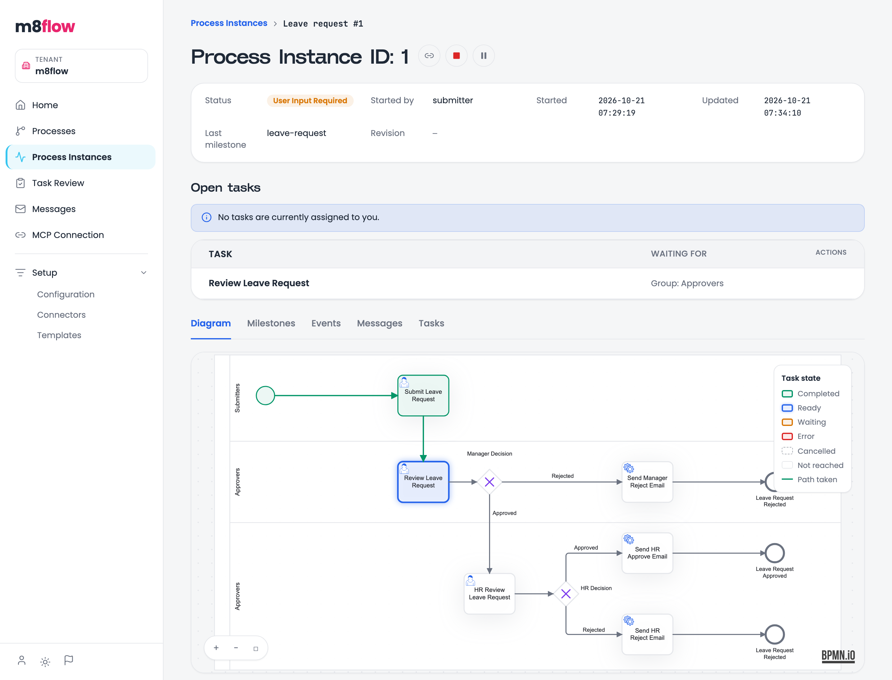

# About process execution

This page follows a process from design to completion: how a process model
becomes startable, how the engine advances an instance, and how human tasks,
timers, and service tasks fit in.

## Process models and their status

A process model is a folder in the tenant's catalog. It holds one primary BPMN
file plus optional DMN, form schema, and Markdown files. A process group is a
folder of process models, and groups can nest.

Each process model has a status, stored in its `process_model.json`:

| Status | Can start instances | Changes to |
|---|---|---|
| `draft` | No | `published` |
| `published` | Yes | `paused`, `draft` |
| `paused` | No | `published`, `draft` |

  

New models start in `draft`. Pausing is reversible and keeps the model's
history. Models created before the status field existed read as `published`,
so they keep working after an upgrade.

When you save a BPMN file, the catalog checks it for constructs the engine
doesn't support and rejects the save if it finds one. See
[BPMN support](../reference/bpmn-support.md) for the list.

## Templates

A template is a reusable, versioned pack of BPMN and supporting files, stored
outside the catalog. You can create a template from scratch, import it from a
ZIP file, or save one from a process model with **Save as template**.

Template versions follow a one-way publish:

- A new template version starts as a draft that you can edit.
- Publishing freezes the version. There's no unpublish.
- Editing a published version creates a new draft version (`V2`, `V3`, and so
  on).
- Only a published version can create a process model.

Template visibility (`PUBLIC`, `TENANT`, or `PRIVATE`) controls who can see a
template. It's separate from whether a version is published.

## Starting an instance

Starting a process model creates a process instance and runs the engine until
the instance can't continue on its own. That happens when it reaches the end,
waits for a person, waits for a timer, or fails. All of this happens inside
one database transaction in the `workflow` host module, so the instance either
saves in a consistent state or doesn't save at all.

An instance starts in one of three ways:

- A user clicks **Start** or **Start process** in the designer.
- An external system calls the trigger endpoint with a tenant API key. See
  [Trigger processes with API keys](../how-to/trigger-processes-with-api-keys.md).
- An AI assistant calls the start tool on the `m8flow-mcp` server.

## Human tasks

A user task pauses the instance until a person completes it. A plain BPMN
task does the same, without a form. The engine
decides who can complete it from the BPMN lane: each lane maps to a group,
and the group's members are the task's candidates. When there's no lane, the
process initiator is the candidate.

A user task binds to a form schema file: a JSON Schema file in the process
model, with an optional companion UI schema file. The designer renders the
form from these files.

People find their tasks in three places:

- **Home** lists the current user's tasks.
- **Task Review** lists pending tasks to review and submit.
- **Process instance detail** shows every open task on that instance and who
  it's waiting for.

Completing a task saves the form data into the instance and lets the engine
continue to the next wait point.

In the following instance, the submitter's task is complete (green) and the
review task is ready (blue) in the Approvers lane, so it waits for that group:

  

## Suspend, resume, and terminate

You can change the course of a live instance in three ways:

- **Suspend** pauses the instance. Its tasks can't be completed until it
  resumes.
- **Resume** continues a suspended instance.
- **Terminate** ends the instance for good. It can't continue afterwards.

Each change is recorded as a process instance event, listed on the
**Events** tab of the instance.

## Timers

Timer events don't run inside a web request. When an instance reaches a timer,
the engine stores a scheduler job with a due time. The Celery task
`m8flow_backend.scheduler.poll_due_task` finds due jobs and advances their
instances. It runs on the `m8flow-run-due` beat schedule, every
`M8FLOW_SCHEDULER_POLL_SECONDS` (10 by default).

The poll runs once per active tenant, with that tenant bound for row-level
security, so a job only ever sees its own tenant's instances.

## Service tasks

A service task calls an external system through a connector. The HTTP
connector family has six operators: `http/GetRequestV2`,
`http/PostRequestV2`, `http/PutRequestV2`, `http/PatchRequestV2`,
`http/DeleteRequestV2`, and `http/HeadRequestV2`. Other families come from
the connectors `m8flow-node-wire-proxy` allows, such as SMTP, Slack,
Salesforce, Stripe, GitHub, n8n, and PostgreSQL.

When the engine reaches a service task, the host prepares the request in this
order:

1. **Connector profile.** If the task has an `m8flow_profile` parameter, the
   host removes it and fills empty operator parameters from the named
   connector profile in the active tenant.
2. **Secrets.** The host replaces every `M8FLOW_SECRET:<key>` sentinel with the
   tenant's stored secret value. If a secret is missing, the task fails rather
   than send the literal sentinel.
3. **Proxy call.** The host posts the command to `m8flow-node-wire-proxy` with
   the shared `X-M8FLOW-Connector-Proxy-Key` header. The proxy runs the
   request and returns the result.
4. **Error masking.** If the call fails, the host removes secret values from
   the error before it records or returns it.

  

[Call external services](../how-to/call-external-services.md) shows how to set
this up.

## Testing a process model

The process-model overview has a **Tests** section. It runs BPMN unit tests
stored as `test_*.json` files in the model, and script-task unit tests stored
on script tasks in the primary BPMN file.

## Next steps

- [Call an external HTTP API from a service task](../how-to/call-external-services.md).
- [Start processes from another system](../how-to/trigger-processes-with-api-keys.md).
- [Check which BPMN elements are supported](../reference/bpmn-support.md).
