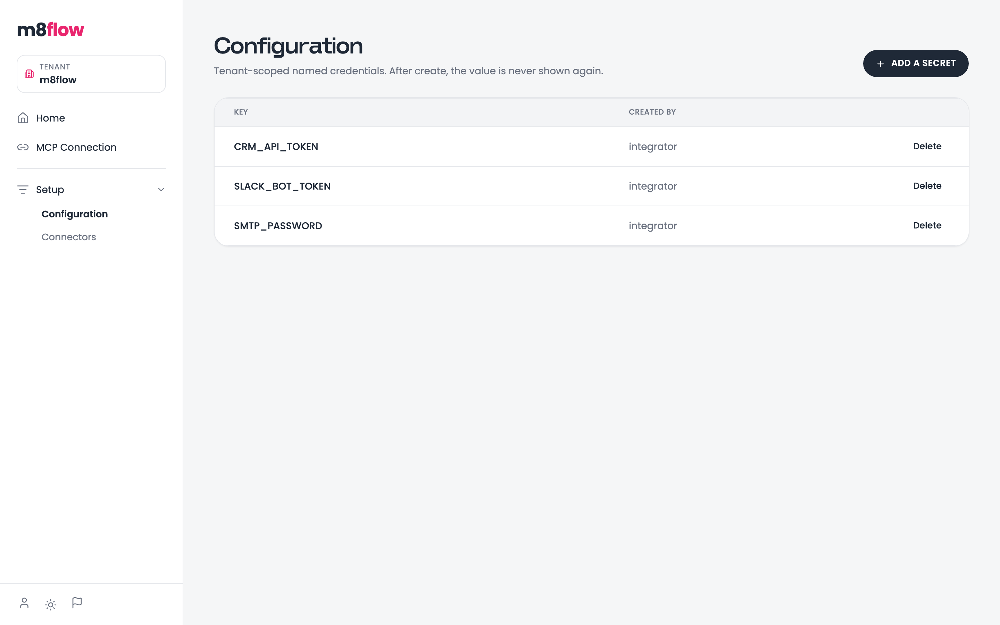
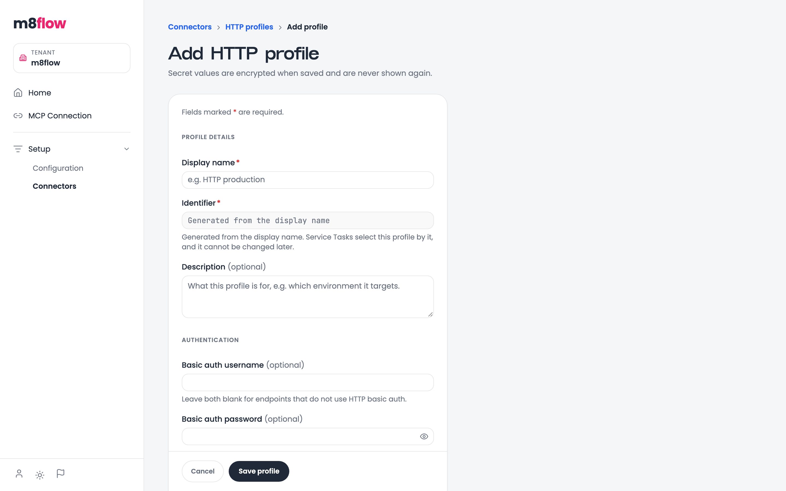
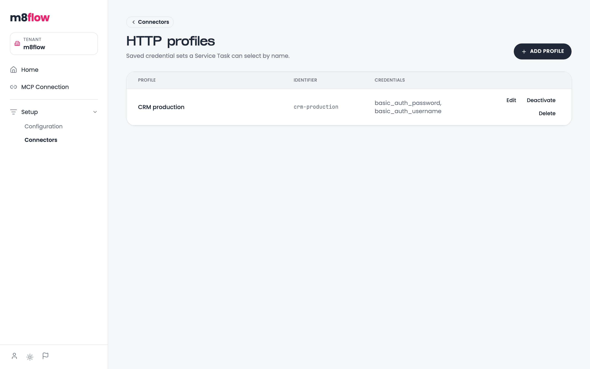

# Call an external service from a process

Use a service task to call an HTTP API or another connector from a process,
with credentials kept out of the BPMN file. You store credentials once, as a
secret or a connector profile, and the host fills them in when the task runs.

## Prerequisites

You need the following:

- A role that can edit process models: `editor` or `tenant-admin`.
- A role that can manage secrets and connector profiles: `integrator` or
  `tenant-admin`. One person can hold both roles.
- A running `m8flow-node-wire-proxy`. The Compose stack starts it on port 6844.
- An active tenant. Secrets and profiles belong to one tenant, so a
  super-admin must select a tenant first.

## Choose where credentials go

m8flow offers two ways to keep a credential out of the diagram:

- **A secret** is one named value, such as an API token. You reference it in
  any service-task parameter as `M8FLOW_SECRET:<key>`.
- **A connector profile** is a named set of credentials for one connector
  family. For the HTTP family, a profile holds optional basic-auth details.
  The task selects the profile by its identifier.

Use a secret for a bearer token in a header. Use a profile for basic auth, or
to switch a whole credential set by name.

## Store a secret

To store a secret, follow these steps:

1. In the sidebar, under **Setup**, click **Configuration**.
2. Click **Add a secret**.
3. Enter a key, for example `CRM_API_TOKEN`. A key is letters, digits, and
   underscores.
4. Enter the value and click **Create**.

m8flow encrypts the value and never shows it again. The list shows only the
keys. To replace a value, open the secret and click **Edit value**.

  

## Create a connector profile

To create a profile, follow these steps:

1. In the sidebar, under **Setup**, click **Connectors**.
2. On the connector family, click **Configure**.
3. Click **Add profile**.
4. Enter a display name. m8flow generates the identifier from it, and the
   identifier can't change later.
5. Fill in the credentials and click **Save profile**.

   

     
   

The profile appears in the family's profile list. A service task selects it by
the identifier shown there:

  

## Configure the service task

To configure a service task, follow these steps:

1. Open the process model's BPMN file in the process modeler.
2. Add a service task to the diagram and select it.
3. In the properties panel, on the **Action** tab, select a **Connector**, then
   a **Connector action**, for example `http/GetRequestV2`.
4. Optional: On the **Config** tab, select a **Connector profile**.
5. On the **Parameters** tab, fill in the parameters. Where a parameter needs a
   secret, enter `M8FLOW_SECRET:<key>` as its value or as part of it.
6. Click **Save**.

Replace `<key>` with the secret's key, for example `CRM_API_TOKEN`.

For example, an `Authorization` header value of
`Bearer M8FLOW_SECRET:CRM_API_TOKEN` sends the stored token at run time.

## What happens at run time

When an instance reaches the task, the host fills empty parameters from the
selected profile, replaces each `M8FLOW_SECRET:<key>` with the stored value,
and sends the request through `m8flow-node-wire-proxy`.

A missing secret fails the task instead of sending the literal sentinel. Error
messages have secret values removed before m8flow stores or shows them.

If the proxy can't be reached, check that `m8flow-node-wire-proxy` is running
and that the backend and proxy use the same `M8FLOW_CONNECTOR_PROXY_API_KEY`.

## Related pages

- [About process execution](../explanation/process-execution.md#service-tasks)
- [Configuration](../reference/configuration.md)
