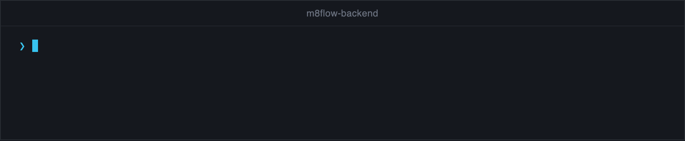

# Develop and test m8flow

Run the backend and designer checks locally before you open a pull request,
and follow the rules that keep changes reviewable. This page assumes you can already
[run m8flow from source](run-from-source.md).

## Backend checks

Run the backend checks from the `m8flow-backend` folder. The lint settings in
`ruff.toml` select files relative to that folder.

To lint the backend, run the following commands:

```bash
cd m8flow-backend
uvx ruff@0.12.1 check . --config ruff.toml
```

To run the backend unit tests, run the following commands in
`m8flow-backend`:

```bash
uv sync --group dev
uv run pytest -n auto
```

`-n auto` runs the tests in parallel, one worker per CPU core. Run a focused test
folder or file first, for example `uv run pytest tests/unit/m8flow_backend/secrets`,
and widen to the full suite before you open a pull request.

The following recording shows a lint run and a focused test run:

<p align="center">
  
</p>

Integration tests that need a running database and Keycloak live in
`m8flow-backend/tests/integration/`. Its README explains how to run them.

## Designer checks

The designer depends on the local `m8flow-bpmn` package, so install that
package first.

To install dependencies, run the following commands from the repository root:

```bash
(cd m8flow-bpmn && npm ci --ignore-scripts)
cd m8flow-designer
npm ci --ignore-scripts
```

To check the designer, run the following commands in `m8flow-designer`:

```bash
npm run lint
npm test
npm run build
```

`npm test` runs the Vitest unit tests. `npm run build` type-checks with
TypeScript and builds the bundle. Run it when you change routing, bundling,
or shared UI code.

## Browser tests

The Playwright tests in `m8flow-designer/e2e/` need the full stack: the backend
on port 6840, Keycloak on port 6842, and the designer on port 6853. They sign
in with the seeded users.

To run them, run the following command in `m8flow-designer`:

```bash
npm run test:e2e
```

To use other credentials, set `M8FLOW_E2E_EDITOR_USERNAME`,
`M8FLOW_E2E_EDITOR_PASSWORD`, `M8FLOW_E2E_SUPER_ADMIN_USERNAME`, and
`M8FLOW_E2E_SUPER_ADMIN_PASSWORD`.

## Component library

The designer's UI components have a Storybook. To open it at
`http://localhost:6854`, run `npm run storybook` in `m8flow-designer`.

## Database migrations

m8flow-owned tables change through Alembic migrations in
`m8flow-backend/migrations/`. Make each migration reversible where you can,
and keep existing data. To apply migrations by hand, run
`./m8flow-backend/bin/run_m8flow_alembic.sh`. The backend launcher also
applies them at startup unless `M8FLOW_BACKEND_UPGRADE_DB=false`.

CI runs a migration check on every pull request.

## Rules for changes

Reviews check the following rules:

- Keep engine calls behind the `workflow` host module. Routes stay thin.
- Don't import the engine's internal libraries (`spiffworkflow`,
  `spiffworkflow_backend`) from `m8flow-backend`.
- Keep tenant isolation and permission checks intact. Don't add queries that
  skip the tenant binding.
- In the designer, decide whether to show an action from
  `POST /v1.0/permissions-check`, never from a role name.
- After a change to sign-in, tokens, tenant selection, or permissions, test
  with a non-admin user such as `editor` or `reviewer`. At minimum, check that
  `GET /v1.0/onboarding` and `GET /v1.0/tasks` still succeed, including for a
  user in two organizations.
- Keep the Keycloak sign-in page on one screen, with the username and password
  together, in both the `m8flow` and `master` realms.
- Don't add a dependency unless you need it, and explain why in the pull
  request.

[`AGENTS.md`](../../AGENTS.md) holds the full list.

## Continuous integration

Each component has its own CI workflow that runs when its files change: build,
tests, static analysis, image build, and image scans. Repository-wide
workflows add licensing, dependency, secret, and CodeQL scans, and a test
matrix across Python and Node.js versions.
Pull requests to `main` run CI without publishing anything.

[Quality and compliance gates](../reference/quality-and-compliance.md) lists
every check and what makes it fail. To run the licensing, secret, SAST, and
vulnerability checks locally, run `./bin/compliance/run-compliance-checks.sh`.
The [workflows README](../../.github/workflows/README.md) covers releases and
deployments.

## Related pages

- [Repository layout](../reference/repository-layout.md)
- [About the m8flow architecture](../explanation/architecture.md)
