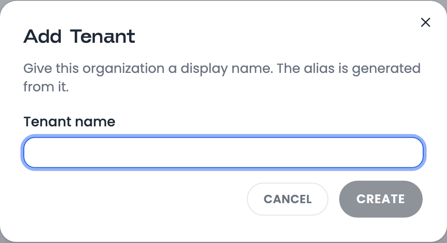
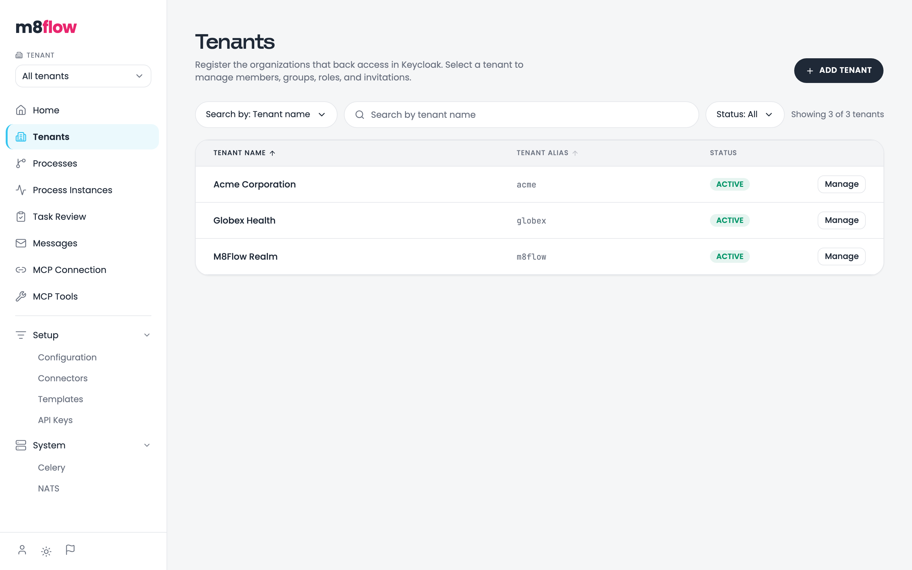
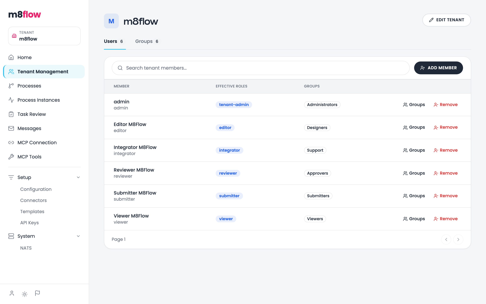
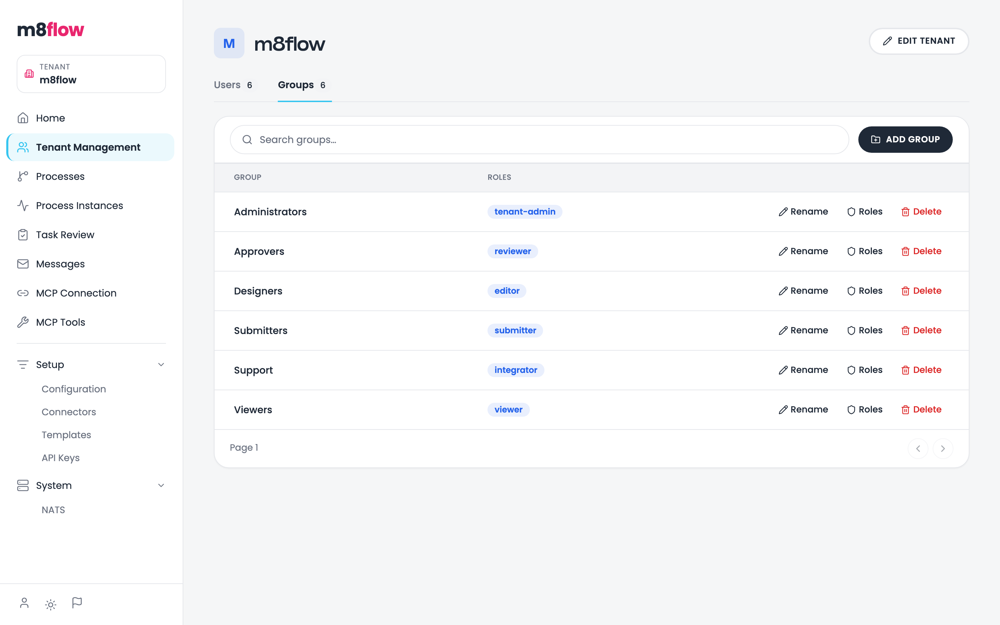

# Manage tenants and members

Create a tenant, give people access to it, and control their roles through
groups. A super-admin creates tenants. A tenant-admin manages members and
groups inside their own tenant.

## Prerequisites

You need the following access:

- To create a tenant or send invitations: the `super-admin` account in the
  master realm. On a local stack, the username and password are both
  `super-admin`.
- To manage members and groups: a `tenant-admin` in the tenant, or the
  `super-admin`.

## Sign in as the super-admin

To sign in to the master realm, follow these steps:

1. Open the designer. The browser goes to the shared-realm sign-in page.
2. Click **Platform Admin Sign In**.
3. Enter the `super-admin` username and password.

## Create a tenant

Each tenant is a Keycloak organization in the shared realm.

To create a tenant, follow these steps:

1. In the sidebar, click **Tenants**.
2. Click **Add Tenant**.
3. Enter a tenant name. m8flow generates the alias from the name and shows it
   under the field.

   

     
   

4. Click **Create**.

The tenant appears in the list with the `ACTIVE` status. The alias can't
change later. Only the display name can, through **Edit Tenant**.

  

## Add an existing user to a tenant

Use **Add Member** for a person who already has a shared-realm account.

To add a member, follow these steps:

1. Open the tenant's management page. As a super-admin, click **Tenants**,
   then **Manage** on the tenant's row. As a tenant-admin, click
   **Tenant Management**.
2. On the **Users** tab, click **Add Member**.
3. Search for the user and select them.
4. Optional: Select the groups to add the member to.
5. Click **Add**.

The member's effective roles come from their groups. There's no separate role
editor for a member. The **Users** tab shows each member's groups and the
roles those groups grant:

  

## Invite a new person

Use an invitation for a person who has no account yet. Only a super-admin can
create, resend, and revoke invitations.

To invite a person, follow these steps:

1. On the tenant's management page, click **Invite User**.
2. Enter the email address, choose the roles, and choose how long the
   invitation stays valid.
3. Click **Send Invitation**.

If email is configured for the tenant, m8flow emails a single-use link. If it
isn't, the dialog shows the invitation URL for you to copy and share.

The invited person opens the link, sets a password of at least 8 characters,
and clicks **Set password and activate**. They then sign in from
**Go to login**. Accepting doesn't sign them in automatically.

Open invitations are on the **Pending invites** tab, where you can resend or
revoke them.

## Grant roles through groups

A group maps to one or more tenant roles, and every member of the group gets
those roles.

To create a group with roles, follow these steps:

1. On the tenant's management page, open the **Groups** tab.
2. Click **Add Group**.
3. Enter a group name and select its roles.
4. Click **Create**.

To change a group's roles later, click **Roles** on the group's row. The
**Groups** tab lists every group with the roles it grants:

  

Deleting a group keeps its members in the tenant. They lose only the roles
that came from that group.

Groups also act as BPMN lanes. A user task in a lane named after a group goes
to that group's members.

## Members of several tenants

A user who belongs to several tenants chooses one after signing in. To work in
another tenant, they switch tenants from the designer. The active tenant is
held in the `m8flow_selected_tenant` cookie, and every page shows that
tenant's data.

## Related pages

- [About multi-tenancy and access control](../explanation/multi-tenancy-and-access.md)
- [Roles and permissions](../reference/roles-and-permissions.md)
