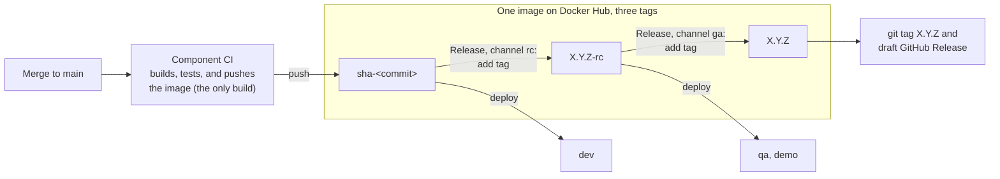

# Release and roll back m8flow

Cut a release candidate, promote it to a general availability (GA) release,
and recover when a release goes wrong. This page is for maintainers with write
access to the repository.

The [workflows README](../../.github/workflows/README.md) describes the CI and
deployment pipelines these steps run on, and the
[versioning policy](../reference/versioning.md) defines what each version
number promises.

## How releases work

m8flow builds each image once, from a merge to `main`, and every deploy and
release reuses that image. A release only adds tags to an image that already
exists, so the image in production is bit-for-bit the one you tested:



The diagram shows these stages:

1. A merge to `main` runs each changed component's CI, which builds the image
   and pushes it to Docker Hub as `docker.io/m8flow/<image>:sha-<commit>`.
2. Deploys to dev, qa, and demo pull an image that CI already pushed. They
   never build one, and they refuse an image that doesn't exist on Docker Hub.
3. A release candidate tags a `main` commit `X.Y.Z-rc` in git, and adds the tag
   `X.Y.Z-rc` to each component's image.
4. A final release adds the tag `X.Y.Z` to the candidate's images, tags the
   candidate's commit `X.Y.Z` in git, and drafts the GitHub Release.

Every image tag is copied by digest. A tag that already exists on a different
image or commit is never moved; the run stops instead.

The release workflow creates the `X.Y.Z` git tag itself, with the
repository's GitHub Actions token. The tag is annotated but not signed by a
maintainer. A release's provenance comes from three things instead: the tested
candidate whose commit it marks, the approval recorded on the `release`
environment, and the GitHub Release's signed checksums and build-provenance
attestations.

### Which image a candidate ships

A component's CI runs, and builds its image, only when a merge changes that
component's files: the `push.paths` list of its workflow, such as
`backend-cicd.yaml`. So for each component, a candidate ships the image of the
last `main` commit, at or before the candidate, that changed those files. The
paths decide what a release contains, so they must list every file the image
is built from.

The release workflow checks every image before it writes anything. If an image
is missing, because its merge build failed or a newer merge replaced it in the
queue, the outcome depends on where you cut the candidate:

- At the tip of `main`, the workflow builds that component once, as
  `sha-<tip>`, and tags that image.
- At an earlier commit, the workflow stops and names the missing image.

### What lands before the candidate

The git release tag marks the candidate's own commit, and the GitHub Release
checks the component versions at that tag. So the release version must be on
`main` before you cut the candidate. The release notes are the one exception:
they're read from `main`'s `CHANGELOG.md` when the GitHub Release is created,
so you can still correct them after the candidate.

## Prerequisites

- Write access to `AOT-Technologies/m8flow`.
- Required reviewers on the repository's `release` environment, in
  **Settings** → **Environments**. A final release waits for their approval;
  without reviewers, the approval passes immediately.
- [uv](https://docs.astral.sh/uv/) and Python 3.12, to run the release scripts.

## Release workflow inputs

The **Release** workflow runs from **Actions** on `main`, and takes the
following inputs:

| Input | Channel `rc` | Channel `ga` |
|---|---|---|
| **channel** | `rc`, the default | `ga` |
| **tag_name** | The candidate, such as `2.1.0-rc`. Leave it empty to increment the patch of the latest candidate. | Required. The release, such as `2.0.0`. |
| **rc_tag** | Not used | Required. The tested candidate, such as `2.0.8-rc`. Its number doesn't have to match the release. |
| **commit_sha** | An earlier `main` commit to tag. Leave it empty to tag the tip of `main`. | Not used; a release is always the candidate's commit. |
| **components** | `all`, or a single component | `all`, or a single component |
| **dry_run** | Plans only: resolves the commit, the tag, and every image, and creates nothing. | The same |

## Prepare the release

To prepare the release, follow these steps:

1. Check that `main` is green: the component CI, **Compliance**,
   **Secret scan**, **CodeQL**, and **Test matrix** workflows.
2. Close or move every open issue in the release's milestone.
3. On a branch, set every component to the release version:

   ```bash
   python3 bin/release/set-version.py <version>
   ```

   Replace `<version>` with the release, for example `2.1.0`.

4. In `CHANGELOG.md`, rename `## [Unreleased]` to
   `## [<version>] - <yyyy-mm-dd>`, add a new empty `## [Unreleased]` before
   it, and add the link reference at the end of the file. Replace
   `<yyyy-mm-dd>` with the planned release date:

   ```markdown
   [<version>]: https://github.com/AOT-Technologies/m8flow/releases/tag/<version>
   ```

5. Open a pull request with these changes and get it reviewed. The release
   notes come from this changelog section, so the review approves them.

After the pull request merges, wait for each component's CI on `main` to
publish its `sha-<commit>` image.

## Cut a release candidate

A release candidate (`X.Y.Z-rc`) is for testing. It doesn't get a GitHub
Release. To cut one, follow these steps:

1. In GitHub, open **Actions** → **Release** → **Run workflow**, on `main`.
2. Leave **channel** as `rc`. Leave **tag_name** empty to increment the patch
   of the latest candidate, or set it, for example `2.1.0-rc`. Leave
   **commit_sha** empty to tag the tip of `main`.
3. Check **dry_run** and run it. The run summary lists, for each component,
   the `sha-<commit>` image that the candidate reuses.
4. Run it again without **dry_run**. The workflow tags the commit and adds the
   candidate tag to each image.

If the dry run reports a missing image, re-run that component's CI for the
commit it names, or cut the candidate at the tip of `main` so the release
builds the image once.

Deploy the candidate to a test environment with each component's workflow,
and test it before you promote it.

## Cut a final release

A final release is tagged `X.Y.Z`, with no `v` prefix, and has a GitHub
Release with notes, software bills of materials (SBOMs), checksums, and
signatures. It promotes the candidate you tested. The candidate's number
doesn't have to match the release: for example, `2.0.0` can promote
`2.0.8-rc`.

In the following steps, `<version>` is the release, such as `2.0.0`, and
`<candidate>` is the tested candidate tag, such as `2.0.8-rc`.

To cut a final release, follow these steps:

1. Open **Actions** → **Release** → **Run workflow** on `main`, with
   **channel** `ga`, **tag_name** `<version>`, and **rc_tag** `<candidate>`.
2. Check **dry_run** and run it. The run checks that `<candidate>` exists on
   `main`, that every `<candidate>` image is published, and that `<version>`
   isn't already a tag on another commit or image.
3. Run it again without **dry_run**, and approve the `release` environment
   when the run asks. The workflow then does the following:

   - Adds the tag `<version>` to each `<candidate>` image, by digest.
   - Tags the `<candidate>` commit `<version>` in git.
   - Checks that the component versions at the tag are `<version>`, and
     creates a **draft** GitHub Release with the
     [release assets](#release-assets).

4. Open the draft on the [releases page](https://github.com/AOT-Technologies/m8flow/releases),
   review it, check **Set as the latest release**, and publish it.
5. Deploy the release with each component's workflow, as described in the
   [workflows README](../../.github/workflows/README.md#deploying).

If a step fails, fix the cause and run the release again. Each step is safe to
repeat: it keeps the tags already written and never moves them. If only the
GitHub Release failed, you can instead run **Actions** → **GitHub Release**
with **version** `<version>`.

### Release assets

A GitHub Release has the following assets. Every asset also gets a
build-provenance attestation.

| Asset | Contents |
|---|---|
| `m8flow-<version>-source.tar.gz` | The source at the tag |
| `m8flow-<version>-backend.cdx.json` | CycloneDX SBOM of the backend's runtime dependencies |
| `m8flow-<version>-designer.cdx.json` | CycloneDX SBOM of the designer's runtime dependencies |
| `m8flow-<version>-DEPENDENCIES.md` | The license of every runtime dependency |
| `SHA256SUMS` | SHA-256 checksums of the preceding assets |
| `SHA256SUMS.sigstore.json` | Keyless Sigstore signature of `SHA256SUMS` |

## Verify a release

Anyone can check that a release's assets came from this repository's workflow.

To verify the checksums and their signature, download the assets and run the
following commands:

```bash
cosign verify-blob SHA256SUMS \
    --bundle SHA256SUMS.sigstore.json \
    --certificate-identity-regexp '^https://github.com/AOT-Technologies/m8flow/\.github/workflows/github-release\.yml@' \
    --certificate-oidc-issuer https://token.actions.githubusercontent.com
sha256sum -c SHA256SUMS
```

To verify an asset's build provenance, run the following command:

```bash
gh attestation verify m8flow-<version>-source.tar.gz --repo AOT-Technologies/m8flow
```

## Roll back

### Roll back a deployment

A component's deploy workflow checks the service's health after it rolls out
the new image, and rolls the workload back to the previous image if the check
fails.

To roll back by hand, run the component's workflow again with the
`image_uri` of the previous release. If the release ran database migrations,
restore the database backup taken before the upgrade first; an older backend
doesn't run against a newer schema. [Upgrade m8flow](upgrade.md#roll-back)
covers backups.

### Withdraw a bad release

Published tags and images are never moved or overwritten, because users may
already depend on them. To withdraw a bad release, follow these steps:

1. Fix the problem on `main`.
2. [Cut a release candidate](#cut-a-release-candidate) from the fix, and test
   it.
3. [Promote the candidate](#cut-a-final-release) as the next patch release
   (`X.Y.Z+1`).
4. Edit the bad release on the releases page: check **Set as a pre-release**
   and add a warning at the top of the notes that names the fixed version.
5. Add a note under the bad version in `CHANGELOG.md`.
6. If the problem is a security vulnerability, publish a
   [security advisory](https://github.com/AOT-Technologies/m8flow/security/advisories)
   that names the affected and fixed versions, as described in
   [SECURITY.md](../../SECURITY.md).

Delete a tag or release only for a legal problem or when it exposed a
secret. In that case, also rotate the secret: deleting the release doesn't
remove copies others have downloaded.

## Related pages

- [Versioning and deprecation policy](../reference/versioning.md)
- [Upgrade m8flow](upgrade.md)
- [Quality and compliance gates](../reference/quality-and-compliance.md)
