# Set up the MCP server and the MCP Tools page

Run the m8flow Model Context Protocol (MCP) server on your machine, connect it to the m8flow stack, and
use the **MCP Tools** page in the designer to list and run the server's tools.
AI clients such as Claude Code and Cursor can connect to the same server.

This page has the following sections:

- [Overview](#overview)
- [Prerequisites](#prerequisites)
- [Step 1: Start the m8flow stack](#step-1-start-the-m8flow-stack)
- [Step 2: Start the MCP server](#step-2-start-the-mcp-server)
- [Step 3: Point the backend and designer at the MCP server](#step-3-point-the-backend-and-designer-at-the-mcp-server)
- [Step 4: Use the MCP Tools page](#step-4-use-the-mcp-tools-page)
- [Optional: Connect an AI client](#optional-connect-an-ai-client)
- [Troubleshooting](#troubleshooting)
- [Reference](#reference)

---

## Overview

The MCP Tools page is a Swagger-style catalog for the m8flow MCP server: it lists every tool
the server exposes and lets a tenant-admin or super-admin run one in the browser.
Requests flow through the stack like this:

<p align="center">
  
</p>

The page never calls the MCP server itself. The backend checks your admin grant, then
forwards your own Keycloak token, so the server sees exactly what your own MCP client would;
tools then call back into the backend REST API to do their work.

## Prerequisites

You need the m8flow repo, Docker Desktop, `uv`, and a tenant-admin or super-admin login.

- **Repo:** a clone of m8flow.
- **Docker Desktop:** runs the m8flow stack.
- **uv:** runs the MCP server from `m8flow-mcp/`.
- **Node.js 20.19 or later:** only for running designer tests or `npm run build` outside Docker.
- **Login:** MCP Tools is admin-only. Use a `tenant-admin` or `super-admin` account; `editor` and `reviewer` cannot open it.

| Service | Local URL | Runs as |
| --- | --- | --- |
| m8flow-backend | http://localhost:6840 | Docker |
| Keycloak | http://localhost:6842 | Docker |
| m8flow-designer (UI) | http://localhost:6853 | Docker |
| m8flow-mcp (MCP server) | http://localhost:8000 | Host process (uv) |

The MCP server is not part of the compose stack. Its Dockerfile build context is broken, so
it runs as a host process.

## Step 1: Start the m8flow stack

Start the stack first, because the MCP server needs the backend (6840) and Keycloak (6842)
up before it starts. Run the following command:

```bash
docker compose --env-file .env -f docker/m8flow-docker-compose.yml up -d
```

Check that all three answer with HTTP 200:

```bash
curl -s -o /dev/null -w "%{http_code}\n" http://localhost:6840/v1.0/healthy
curl -s -o /dev/null -w "%{http_code}\n" http://localhost:6853/
curl -s -o /dev/null -w "%{http_code}\n" \
    http://localhost:6842/realms/m8flow/.well-known/openid-configuration
```

`keycloak-master-admin-init` shows as **Exited** after startup. That is expected: it is a
one-shot init job.

## Step 2: Start the MCP server

Run the MCP server in **remote (HTTP) mode** on port 8000 with realm-token acceptance on; in
its default stdio mode it opens no port.

1. Install dependencies (add `--extra dev` if you also want pytest, ruff and mypy):

    ```bash
    cd m8flow-mcp && uv sync --extra dev
    ```

2. Create `m8flow-mcp/.env` **only if it does not exist yet**. `cp` overwrites an existing
   file, including any client secret in it. Run the following command:

    ```bash
    cd m8flow-mcp && [ -f .env ] || cp sample.env .env
    ```

    Check these values in it: `PORT=8000`, `M8FLOW_API_URL=http://localhost:6840`,
    `KEYCLOAK_URL=http://localhost:6842`, `KEYCLOAK_REALM=m8flow`.

3. Start the server. Variables on the command line override `.env`:

    ```bash
    cd m8flow-mcp && SERVER_TYPE=remote ACCEPT_REALM_TOKENS=true \
        ACCEPTED_TOKEN_REALMS="m8flow master" LOG_FORMAT=text \
        uv run python -m src.main
    ```

4. Confirm it is up. The last log lines must say `initialized in remote mode` and
   `Starting m8flow MCP server in HTTP mode on 0.0.0.0:8000`. Then, from a second terminal:

    ```bash
    curl -s http://localhost:8000/health
    ```

    Expected: `{"status":"healthy","server":"m8flow-mcp","version":"1.0.0"}`.

| Setting | Value | Why |
| --- | --- | --- |
| `SERVER_TYPE` | `remote` | `stdio` (the sample default) talks over the terminal and never listens on 8000 |
| `ACCEPT_REALM_TOKENS` | `true` | Accepts the signed-in user's Keycloak token that the backend forwards for MCP Tools |
| `ACCEPTED_TOKEN_REALMS` | `m8flow master` | Tenant users sign in via `m8flow`, super-admins via `master`; the realms have different signing keys |
| `LOG_FORMAT` | `text` | Readable logs instead of JSON |

The MCP endpoint is `http://localhost:8000/mcp`; the root path serves only `/health`. The
many `griffe ... No type or annotation` warnings at startup are harmless docstring noise.

## Step 3: Point the backend and designer at the MCP server

Set two variables in the **root** `.env` (not `m8flow-mcp/.env`), then rebuild the backend
and designer. The variables are:

```bash
M8FLOW_MCP_SERVER_URL=http://localhost:8000/mcp
M8FLOW_MCP_SERVER_INTERNAL_URL=http://host.docker.internal:8000/mcp
```

| Variable | Read by | Must be reachable from |
| --- | --- | --- |
| `M8FLOW_MCP_SERVER_URL` | Designer (MCP Connection page, baked in at build) and the backend's fallback | Your browser and AI clients |
| `M8FLOW_MCP_SERVER_INTERNAL_URL` | Backend only (MCP Tools page). **Development only** | Inside the backend container |

Locally one URL cannot serve both: inside the container `localhost` is the container itself,
and your Mac cannot resolve `host.docker.internal`. Both URLs must end in `/mcp`.

Rebuild so the designer bakes in the URL and the backend picks up the env:

```bash
docker compose --env-file .env -f docker/m8flow-docker-compose.yml \
    up -d --build m8flow-backend m8flow-designer
```

A plain `up -d` restarts containers without rebuilding, so the designer keeps the old (empty)
URL. After a `build --no-cache`, still run `up -d` to recreate the containers from the new
images.

Optional check that the backend container can reach the MCP server:

```bash
docker exec m8flow-m8flow-backend-1 python -c \
    "import httpx; print(httpx.get('http://host.docker.internal:8000/health').text)"
```

## Step 4: Use the MCP Tools page

Open the [MCP Tools page](http://localhost:6853/mcp-tools) (sidebar: **MCP Tools**) as a tenant-admin or
super-admin: it lists every tool the MCP server exposes and lets you run one.

**Who sees it.** `tenant-admin` and `super-admin` only. For `editor` and `reviewer` the
sidebar item is hidden, `/mcp-tools` redirects home, and the API returns 403. Super-admins can
browse with **All tenants** selected; pick a tenant before running a tool so it runs in that
tenant's scope.

**Header.** Shows the server URL the backend uses, the MCP protocol version and the tool count
(about 55 locally), plus a status pill:

| Pill | Meaning |
| --- | --- |
| Connected · N ms | Server reachable and your token accepted |
| Not authorized | Server reachable but it rejected your token |
| Unreachable | Backend could not reach the server |
| Connection check failed | The check itself was refused (for example, 403 for your role) |

**Test connection** re-checks the server and, if the catalog failed, reloads it. When loading
fails, the red banner shows the backend's exact reason (see [Troubleshooting](#troubleshooting)).

**Find a tool.** Type in **Search tools…** (matches name and description) or pick a category
such as BPMN, Cleanup or Process Instances. Tools are grouped by category.

**Read a tool.** Click a row to expand it. The badge says **read** (only fetches data) or
**write** (changes data). The parameter table lists each parameter's name, type, description
and whether it is required.

**Run a tool (Try it).**

1. Expand the tool and fill its fields under **Try it**. Integers and numbers are sent as
   numbers, booleans use a true/false dropdown, and object or array fields take JSON.
2. Click **Execute**. Missing required fields or invalid JSON are flagged per field and
   nothing is sent.
3. A **read** tool runs at once. A **write** tool first asks **Run &lt;tool&gt;?**: click
   **Run it** to proceed.
4. The result appears as formatted JSON under the button. A failure shows the backend's reason
   instead.

A safe first try: expand `count_process_models` (read) and click **Execute**.

Write tools act on real data in the selected tenant. The backend refuses a write call without
confirmation (400 `confirmation_required`), so the dialog cannot be skipped by calling the API
directly.

## Optional: Connect an AI client

The **MCP Connection** page (http://localhost:6853/mcp-connection) shows
`http://localhost:8000/mcp` with ready-made setup for Claude Code, Cursor and Claude.ai. It
only displays the URL; the MCP server must be running for clients to connect.

Claude Code:

```bash
claude mcp add --transport http m8flow http://localhost:8000/mcp
```

Cursor (`.cursor/mcp.json`):

```json
{"mcpServers": {"m8flow": {"url": "http://localhost:8000/mcp"}}}
```

With the Step 2 setup, browser login is off: the server logs that OAuth discovery is omitted,
and each client must send its own Keycloak bearer token in the request's authorization
header. For interactive browser login, set `MCP_OIDC_BASE_URL=http://localhost:8000` and the
Keycloak client secret in `m8flow-mcp/.env`, and keep `ACCEPT_REALM_TOKENS=true` so the MCP
Tools page still works alongside it.

## Troubleshooting

Most local failures are one of these; the page's red banner shows the backend's exact reason,
which is the first column of the following table.

| Symptom | Cause | Fix |
| --- | --- | --- |
| `localhost:8000` refused; log says `stdio mode` | `SERVER_TYPE=stdio` in `m8flow-mcp/.env` | Restart with `SERVER_TYPE=remote` ([Step 2](#step-2-start-the-mcp-server)) |
| Banner: "M8FLOW_MCP_SERVER_URL is not configured." | Root `.env` MCP URLs empty when the backend started | Set both URLs ([Step 3](#step-3-point-the-backend-and-designer-at-the-mcp-server)), then `up -d --build m8flow-backend` |
| Banner: "Could not connect to the MCP server."; pill **Unreachable** | MCP server down, or the backend dialing `localhost` from inside its container | Start the server; set `M8FLOW_MCP_SERVER_INTERNAL_URL=http://host.docker.internal:8000/mcp` |
| Banner: "Not authorized to reach the MCP server (HTTP 401)."; pill **Not authorized** | MCP server rejects the forwarded user token | Run it with `ACCEPT_REALM_TOKENS=true` and `ACCEPTED_TOKEN_REALMS="m8flow master"` |
| Works for super-admin, but tenant-admin sees "Not allowed" and **Connection check failed** | Tenant was seeded before the MCP Tools grants existed | Fixed automatically: the next request re-imports the tenant's grants. If it persists, sign out and back in |
| MCP Connection page says "not configured" after setting the URL | Designer image built before the URL was set | `up -d --build m8flow-designer`, then hard-reload (Cmd+Shift+R) |
| No **MCP Tools** in the sidebar | Your role is not tenant-admin/super-admin, or the designer image is old | Sign in as tenant-admin; rebuild the designer |
| Red banners for about 30 s, then fine | MCP server was restarting | None; click **Test connection** once it is back |
| `uv sync` removed pytest, ruff, mypy | Dev tools are an optional extra in `m8flow-mcp` | `uv sync --extra dev` |
| `m8flow-mcp/.env` lost its custom values | `cp sample.env .env` overwrote it | Restore your values; copy only when no `.env` exists |
| Designer tests fail on `localStorage` (Node 25+) | Node's built-in Web Storage shadows jsdom's | `NODE_OPTIONS=--no-webstorage npx vitest run`, or use Node 24 |

## Reference

**Environment variables**

| Variable | File | Local value | Deployed |
| --- | --- | --- | --- |
| `M8FLOW_MCP_SERVER_URL` | root `.env` | `http://localhost:8000/mcp` | Public URL, for example `https://qa.m8flow.ai/mcp` |
| `M8FLOW_MCP_SERVER_INTERNAL_URL` | root `.env` | `http://host.docker.internal:8000/mcp` | Leave empty (development only) |
| `SERVER_TYPE` | `m8flow-mcp/.env` | `remote` | `remote` |
| `PORT` | `m8flow-mcp/.env` | `8000` | Per deployment |
| `M8FLOW_API_URL` | `m8flow-mcp/.env` | `http://localhost:6840` | Backend URL |
| `KEYCLOAK_URL` / `KEYCLOAK_REALM` | `m8flow-mcp/.env` | `http://localhost:6842` / `m8flow` | Per deployment |
| `ACCEPT_REALM_TOKENS` | `m8flow-mcp/.env` | `true` | `true` (required for MCP Tools) |
| `ACCEPTED_TOKEN_REALMS` | `m8flow-mcp/.env` | `m8flow master` | `m8flow master` |
| `MCP_OIDC_BASE_URL` | `m8flow-mcp/.env` | Empty (browser login off) | Public MCP URL (browser login on) |

**Backend endpoints** (all under `/v1.0/m8flow`, caller's token forwarded to the MCP server)

| Method + path | Returns | Errors |
| --- | --- | --- |
| `GET /mcp-tools` | Server URL, protocol version, tool count, tools with parameters | 503 not configured; 502 unreachable or not authorized |
| `GET /mcp-tools/ping` | `ok`, `latency_ms`, `protocol_version`, `authorized` | Always 200 for a permitted caller |
| `POST /mcp-tools/execute` | `{result}`; body `{tool_name, arguments, confirm}` | 400 `confirmation_required`, 404 `tool_not_found`, 502 `mcp_call_failed` |

**Permissions** (`m8flow-backend/src/m8flow_backend/config/permissions/m8flow.yml`, groups
`tenant-admin` and `super-admin`): `read-mcp-tools-catalog` (read `/m8flow/mcp-tools`),
`read-mcp-tools-ping` (read `/m8flow/mcp-tools/ping`), `execute-mcp-tools` (create
`/m8flow/mcp-tools/execute`).

**Deployed environments** set only `M8FLOW_MCP_SERVER_URL`; the public URL is reachable from
the backend too. The MCP server there must run with `ACCEPT_REALM_TOKENS=true`, or browser
login rejects the token the backend forwards and the page shows "Not authorized".

## Related pages

- [Configuration](../reference/configuration.md#mcp-server)
- [Roles and permissions](../reference/roles-and-permissions.md)
