# Trigger processes from external systems

Let another system, such as a webhook sender or a scheduled job, start m8flow
processes over HTTP. The caller authenticates with a tenant API key, not a
user sign-in, and m8flow delivers the trigger through NATS JetStream.

## Prerequisites

You need the following:

- A `tenant-admin` account in the tenant. Only a tenant-admin can create API
  keys.
- A published process model to start.
- The main Compose stack running. The NATS server joins its `m8flow_default`
  network, so start the main stack first.

## Turn on NATS

The trigger path needs the NATS server and the `m8flow-nats-consumer`
service. Both are off by default.

To turn on NATS, follow these steps:

1. In `.env`, set the following values:

   ```bash
   M8FLOW_NATS_ENABLED=true
   M8FLOW_NATS_MONITORING_ENABLED=true
   M8FLOW_NATS_TOKEN_SALT=<salt>
   ```

   Replace `<salt>` with a private value of at least 32 characters. To make
   one, run `openssl rand -hex 32`. The backend and the consumer must share
   the same salt, and changing it later invalidates every API key already
   issued.

2. Start the NATS server:

   ```bash
   docker compose --env-file .env \
       -f docker/m8flow-nats-docker-compose.yml up -d
   ```

3. Restart the main stack with the `nats` profile, so the consumer starts and
   the backend reads the new values:

   ```bash
   docker compose --env-file .env --profile nats \
       -f docker/m8flow-docker-compose.yml up -d
   ```

## Create an API key

To create a key, follow these steps:

1. Sign in as a tenant-admin.
2. In the sidebar, click **API Keys**.
3. Click **Create API key**.
4. Enter a label, for example `Billing webhook`.
5. Optional: In **Allowed processes**, enter the process model identifiers
   the key may start, separated by commas. Leave it blank to allow any process
   in the tenant.
6. Choose when the key expires, and click **Create**.
7. Copy the key. m8flow shows it only once.

The key appears in the list with its allowed processes, expiry, and status:

<p align="center">
  
</p>

The process starts as the user who created the key, so that user's permissions
apply to the new instance.

## Send a trigger

To start a process, call the trigger endpoint with the key in the
`X-M8FLOW-NATS-API-Key` header:

```bash
curl -X POST "http://localhost:6840/v1.0/m8flow/events/m8flow-trigger" \
    -H "Content-Type: application/json" \
    -H "X-M8FLOW-NATS-API-Key: <api-key>" \
    -d '{"processIdentifier": "<process-model-id>", "data": {"invoice_id": 9921}}'
```

Replace the following:

- `<api-key>`: the key you copied when you created it.
- `<process-model-id>`: the process model's identifier, including its
  process group, for example `billing/invoice-paid`.

The `data` value can be any JSON value. m8flow stores it as process instance
metadata.

The response carries the created process instance. If the consumer doesn't
reply in time, the response has `process_instance: null`, and the instance
may still start later.

## How a trigger travels

The backend never forwards the raw key. It checks the key and its allowed
processes, then publishes a signed event to the
`m8flow.events.<tenant-slug>.trigger` subject. The consumer verifies the
signature, rejects events older than `M8FLOW_NATS_TRIGGER_MAX_AGE_SECONDS`
(300 by default), checks the key again, drops duplicate events, and starts the
process. Events published to NATS directly, without the backend's signature,
are rejected.

<p align="center">
  
</p>

## Check delivery

As a super-admin, open **System** > **NATS** in the sidebar to see streams,
consumers, and the outcome of each trigger event. A tenant-admin can read the
event outcomes for their own tenant through the API.

## Revoke a key

To revoke a key, click **Revoke** on its row on the **API Keys** page. The key
stops working at once, and integrations that use it fail.

## Related pages

- [About process execution](../explanation/process-execution.md)
- [HTTP API](../reference/http-api.md)
