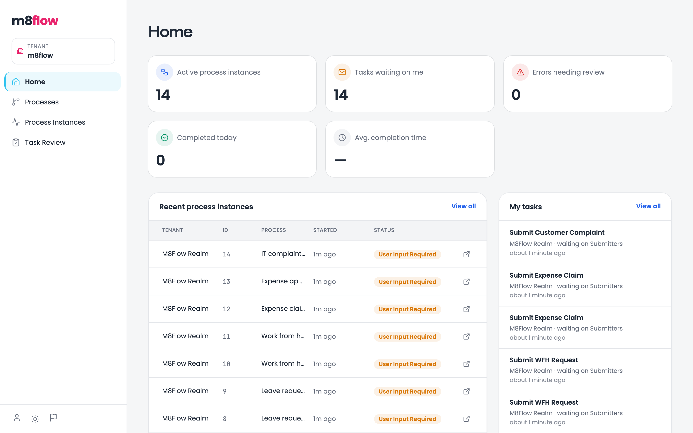
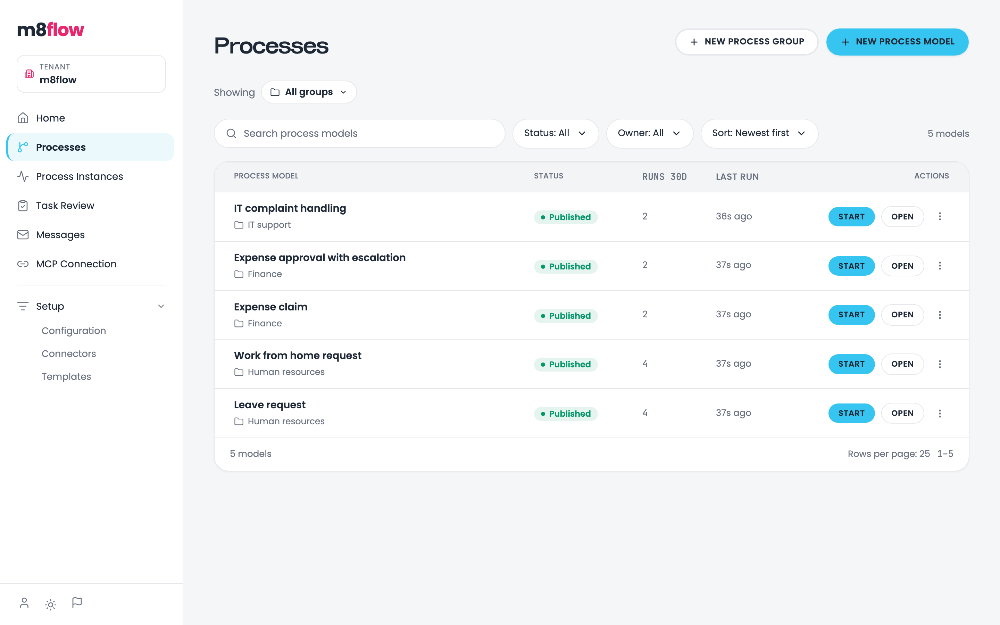
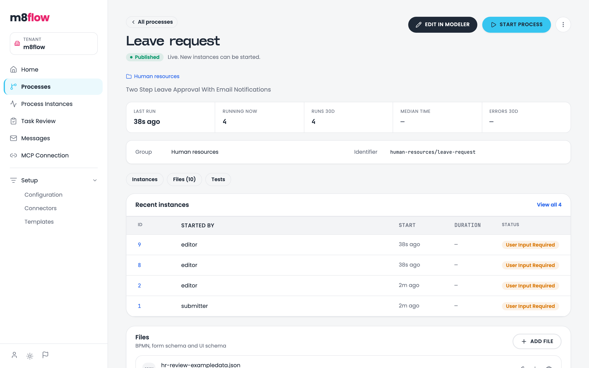
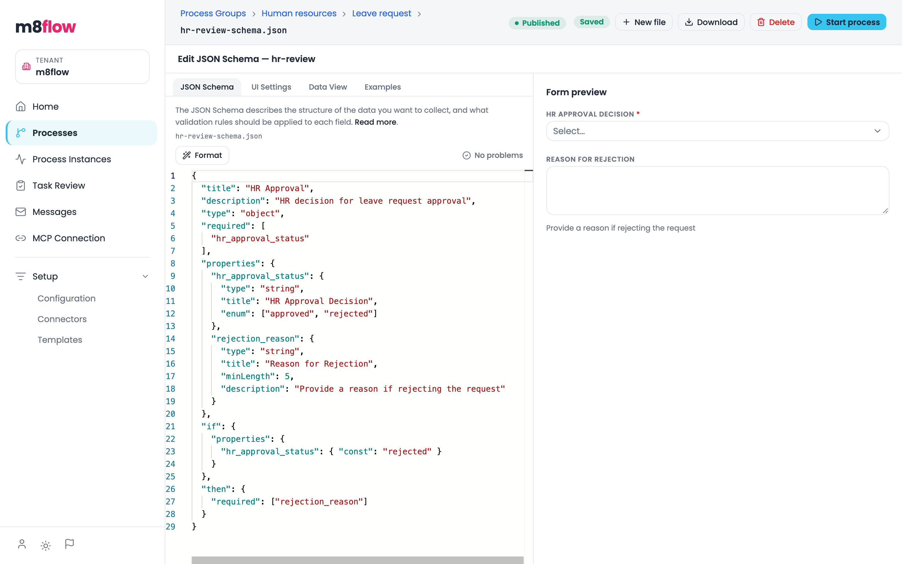
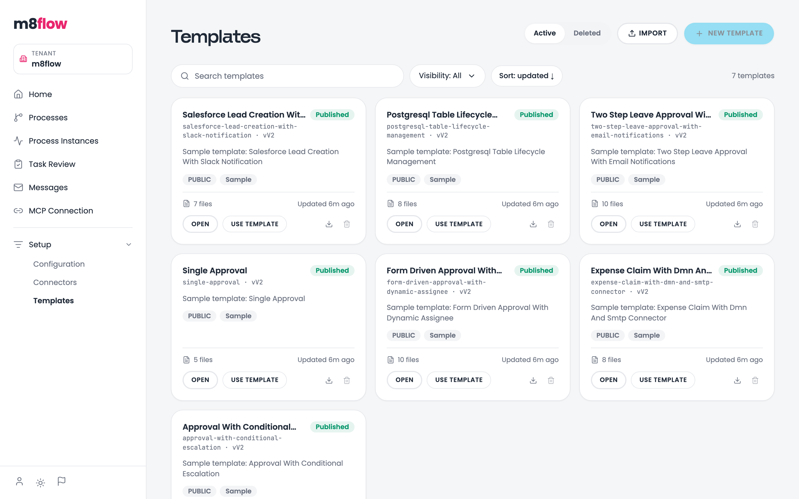
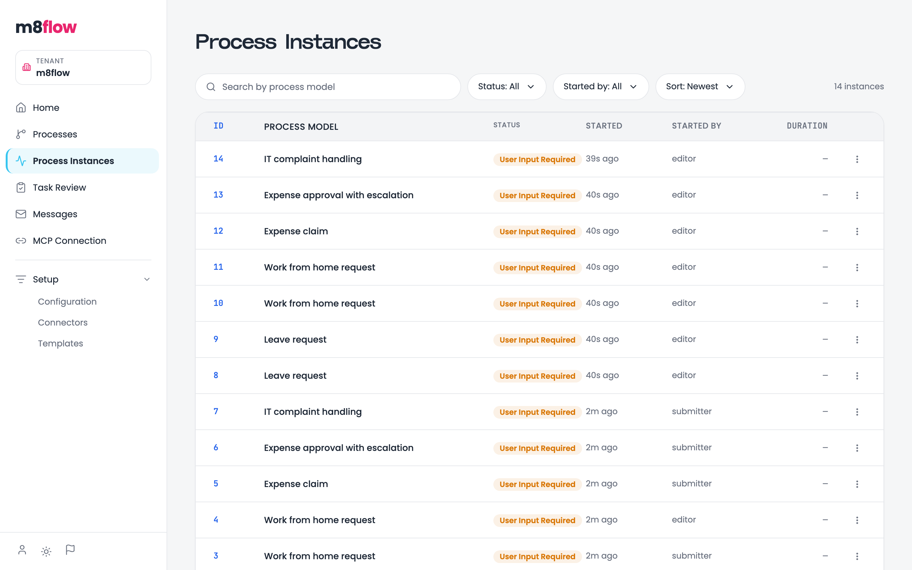
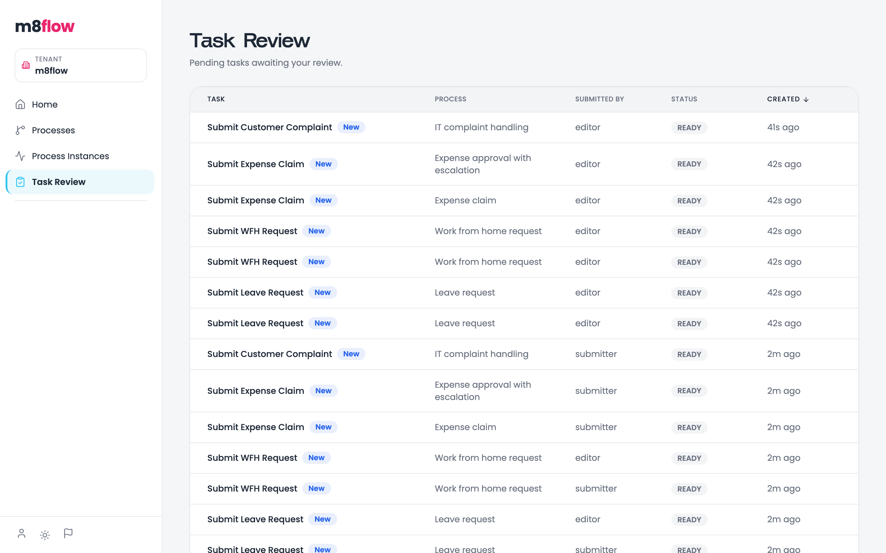
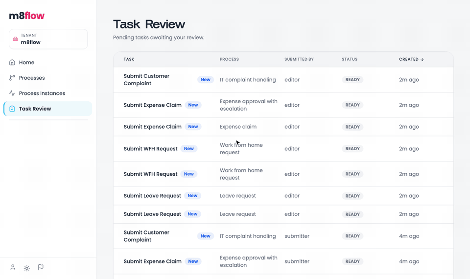
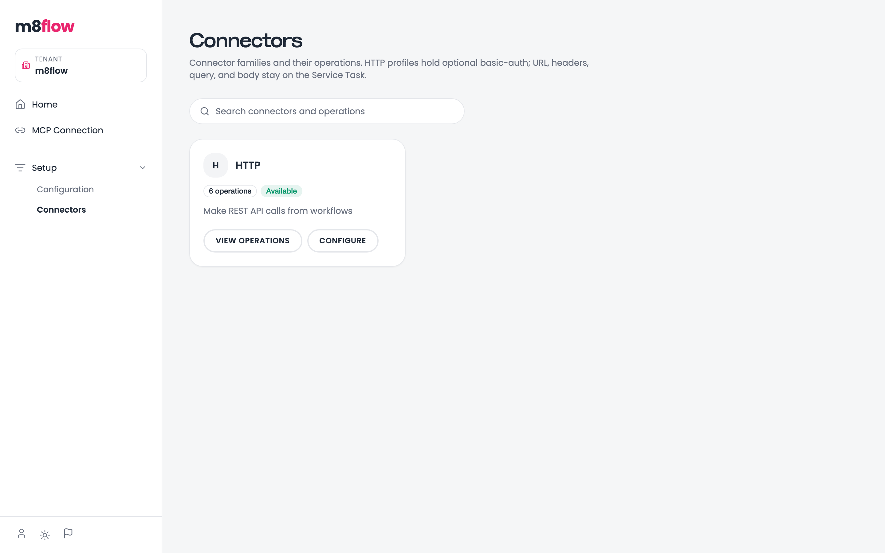
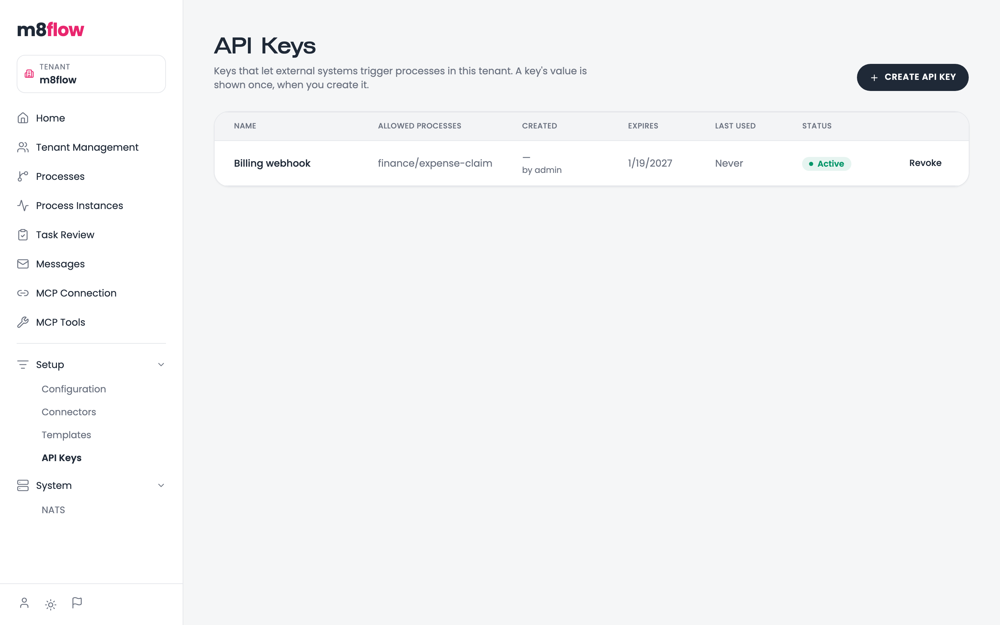

# A tour of the m8flow designer

The m8flow designer is the web app where people model processes, run them,
and work their tasks. This tour walks through each area in the order a
process moves: design it, run it, connect it, then govern who can do what.
Each section names the roles that see the page.

The following recording moves through the main pages: Home, the process
catalog, a process model, the modeler, a live process instance, and the
template gallery:

  

The sidebar shows only the pages your role can use. **Home**, **Processes**,
**Process Instances**, and **Task Review** are daily work. **Setup** holds
**Configuration**, **Connectors**, **Templates**, and **API Keys**.
Administrators also see **Tenant Management**, **MCP Tools**, and **System**,
and platform administrators see **Tenants**.

## Sign in

m8flow signs you in through Keycloak, on one page that asks for your username
and password together. Platform administrators use the **Platform admin sign
in** link on the same page. If you belong to more than one organization,
m8flow then asks which tenant to work in.

  

## Home

**Home** is your starting point after sign-in. Five cards count the active
process instances, the tasks waiting on you, errors needing review, instances
completed today, and the average completion time. Under the cards are the recent
process instances in your tenant and **My tasks**, with a link to each.

  

## Design

### The process catalog

**Processes** lists every process model in the tenant, with its process
group, status, runs in the last 30 days, and last run. Filter by group,
status, or owner, start a published model with **Start**, or create a group
or model.

Seen by: `editor`, `tenant-admin`, `submitter`, `viewer`.

  

### The process-model overview

Opening a model shows its overview: status, run statistics, group and
identifier, recent instances, files, and tests. The header holds **Edit in
modeler** and **Start process**, or **Publish** while the model is a draft.
The menu holds **Copy**, **Save as template**, **Pause**, and **Unpublish**.

  

### The process modeler

The process modeler is a BPMN 2.0 canvas with a palette and a properties
panel. Select an element to set its details: the form a user task shows, the
connector a service task calls, the timer on an event, or the condition on a
gateway. Lanes assign user tasks to groups, so in the following leave
approval, submitters fill in the request and approvers review it.

  

### Forms and decision tables

A user task binds to a form schema file in the same process model. The form
editor shows the JSON Schema, UI settings, example data, and a live preview of
the form a person will fill in. DMN files open in a decision-table editor,
and business rule tasks evaluate them at run time.

  

### Templates

**Templates** is a gallery of reusable process packs. Each template has
versions: publish one to freeze it, then **Use template** to create a process
model from it in one step. Visibility decides who sees a template: only you,
your tenant, or all tenants. m8flow ships sample templates for approvals,
escalations, email notifications, Salesforce, Slack, and PostgreSQL.

Seen by: `editor`, `tenant-admin`, `viewer` (read-only).

  

## Run

### Process instances

**Process Instances** lists every run in the tenant, with its status, who
started it, when, and how long it took. Search by process model, and filter
by status or by who started it.

  

### Process instance detail

An instance's page shows its status and metadata, the open tasks and who each
one waits for, and tabs for the diagram, milestones, events, messages, and
tasks. The diagram colours each task by state. In the following instance, the
request was submitted (green) and the review is ready (blue), waiting for the
Approvers group. Users who may control the instance see **Suspend** and
**Terminate** in the header.

  

### Task Review

**Task Review** is the inbox for tasks waiting on you, newest first. Opening a
task shows its form, the approval chain so far, the activity on the instance,
and **Submit**.

Seen by: `reviewer`, `submitter`, `editor`, `tenant-admin`.

  

The following recording opens a leave request from the inbox, fills in its
form, and submits it, which sends the request on to the approvers:

  

## Connect

### Connectors

**Connectors** lists the connector families a service task can call, with
their operations. The HTTP family has six operations, one per HTTP method.
**Configure** opens its connector profiles: named credential sets that a
service task selects by name, so the diagram never holds a password.

Seen by: `integrator`, `tenant-admin`, `editor`.

  

### Configuration

**Configuration** stores the tenant's secrets. You type a value once; after
that, m8flow never shows it again. Service tasks use a secret as
`M8FLOW_SECRET:<key>`.

Seen by: `integrator`, `tenant-admin`.

  

### API Keys

**API Keys** creates keys that let external systems start processes in the
tenant. You can limit a key to certain processes and give it an expiry. The
key's value is shown once, when you create it.

Seen by: `tenant-admin`.

  

### MCP Connection and MCP Tools

**MCP Connection** shows how to connect Claude Code, Cursor, or Claude.ai to
the m8flow MCP server. **MCP Tools** lists every tool the server offers and
lets an administrator run one from the browser. Both pages need the MCP
server URL configured; see
[Set up the MCP server and the MCP Tools page](how-to/set-up-mcp-tools.md).

## Govern

### Tenant Management

**Tenant Management** is where a tenant-admin manages the tenant's members and
groups. Each member's effective roles come from their groups, and each group
grants one or more roles.

Seen by: `tenant-admin`, `super-admin`.

  

### Tenants

**Tenants** is the platform administrator's registry of organizations. Add a
tenant, search and filter the list, and open any tenant to manage its
members, groups, and invitations. The **Tenant** control at the top of the
sidebar switches the data shown between all tenants and one tenant.

Seen by: `super-admin`.

  

### System

**System** holds operations pages. Tenant admins see **NATS**, with the
outcome of each trigger event in their tenant. Platform admins also see the
NATS streams and consumers, and **Celery** for the background workers.

## Related pages

- [Quick start](tutorials/quick-start.md)
- [Roles and permissions](reference/roles-and-permissions.md)
- [About process execution](explanation/process-execution.md)
