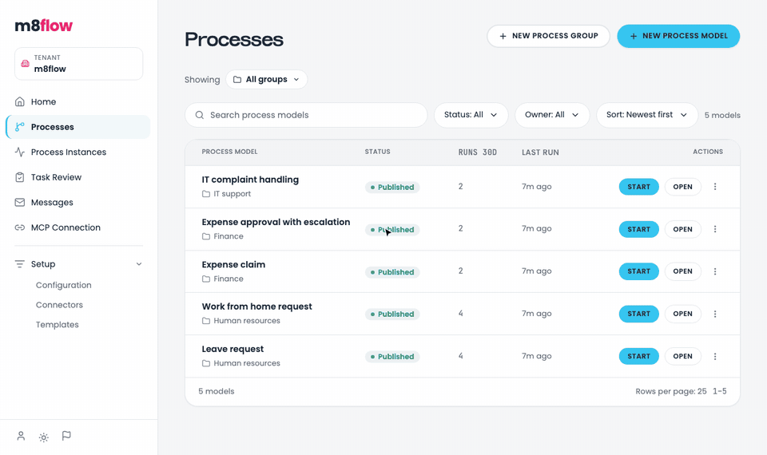
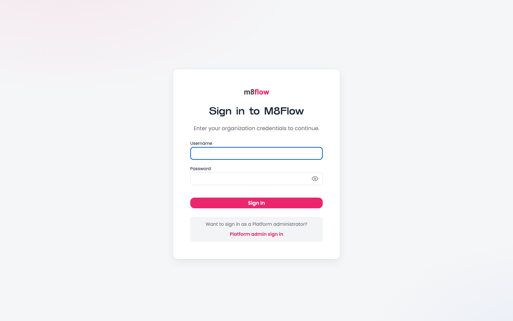
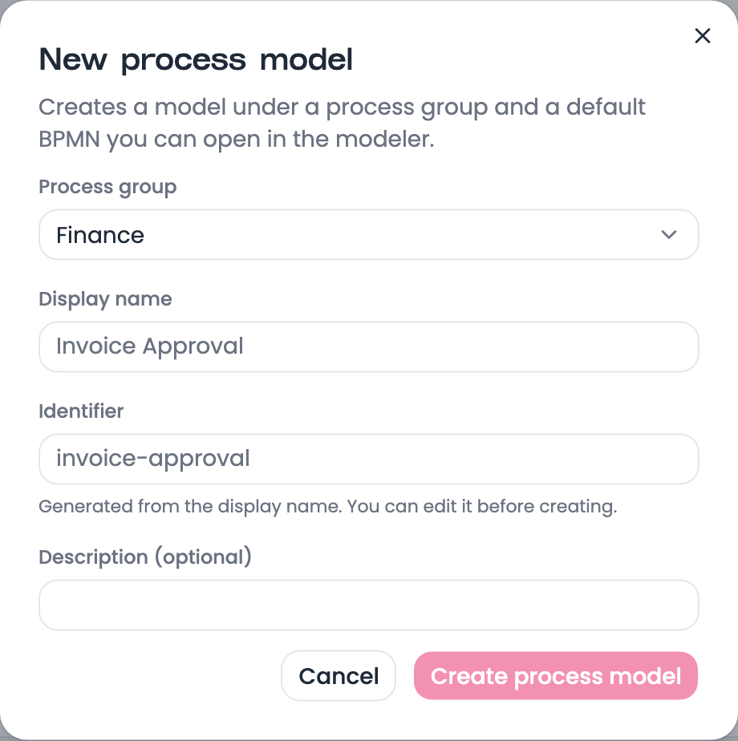
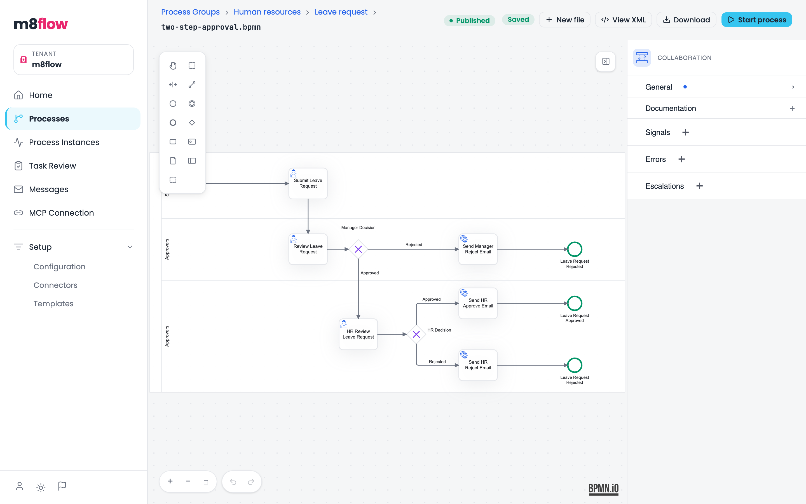

# Quick start

In this tutorial, you start the full m8flow stack with Docker Compose, sign in
as a process designer, and build, publish, and run your first process model.

The following recording shows the whole flow you're about to follow, from an
empty process group to a completed process instance:

<p align="center">
  
</p>

## Before you begin

You need the following tools:

- [Git](https://git-scm.com/downloads)
- [Docker Desktop](https://www.docker.com/products/docker-desktop/), or Docker
  Engine with Compose v2

The stack publishes host ports 6840 to 6853. If another program already uses
one of them, see [Services and ports](../reference/services-and-ports.md) to
change it.

## Step 1: Get the code and configuration

To get the code and a working configuration, follow these steps:

1. Clone the repository and enter it:

   ```bash
   git clone https://github.com/AOT-Technologies/m8flow.git
   cd m8flow
   ```

2. Copy the sample environment file to `.env`:

   ```bash
   cp sample.env .env
   ```

   On Windows PowerShell, run `Copy-Item sample.env .env` instead.

The sample values are for local use only. Before you deploy m8flow anywhere
else, replace every secret in `.env`. The
[configuration reference](../reference/configuration.md) lists them.

## Step 2: Start the stack

The first start must include the `init` profile. It runs one-time jobs that
create the MinIO buckets, set up the Keycloak `super-admin` user, and sync the
seed process models and templates.

To start the stack for the first time, run the following command:

```bash
docker compose --env-file .env --profile init \
    -f docker/m8flow-docker-compose.yml up -d --build
```

The first build takes several minutes. On later starts, leave out
`--profile init`.

To check that the backend is ready, run the following command:

```bash
curl http://localhost:6840/v1.0/status
```

The output is similar to the following:

```json
{ "healthy": true, "ok": true, "status": "ok" }
```

## Step 3: Sign in as a designer

The stack seeds six users in the `m8flow` organization. Each user's initial
password is the same as the username, and Keycloak asks for a new password at
first sign-in.

| Username | Tenant role |
|---|---|
| `admin` | `tenant-admin` |
| `editor` | `editor` |
| `integrator` | `integrator` |
| `reviewer` | `reviewer` |
| `submitter` | `submitter` |
| `viewer` | `viewer` |

To sign in, follow these steps:

1. Open [the designer at localhost:6853](http://localhost:6853/). The browser
   goes to the Keycloak sign-in page, which asks for the username and password
   on one screen.

   <p align="center">
     
   </p>

2. Enter `editor` as the username and `editor` as the password.
3. Set a new password when Keycloak asks for one.

The designer opens on the **Home** page. Because `editor` belongs to one
organization, m8flow selects that tenant for you.

## Step 4: Create a process group and a process model

A process model lives in a process group, which works like a folder in the
tenant's catalog.

To create both, follow these steps:

1. In the sidebar, click **Processes**.
2. Click **New process group**, enter `Getting started` as the display name,
   and click **Create group**.
3. Click **New process model**.
4. In **Process group**, select **Getting started**.
5. Enter `Hello m8flow` as the display name. m8flow fills in the identifier
   `hello-m8flow` from it.

   <p align="center">
     
   </p>

6. Click **Create process model**.

m8flow creates the model in the `draft` status with a default diagram: a start
event, one task, and an end event. The designer opens the new model's
overview.

## Step 5: Look at the diagram

To open the diagram, click **Open in modeler** at the top of the
process-model overview.

The process modeler opens with the palette on the left, the canvas in the
middle, and the properties panel on the right. Select any element to edit its
details. You can leave the default diagram as it is for this tutorial, so go
back to the overview with **All processes** or your browser's back button.

The following figure shows the modeler with a larger process, the sample
leave request:

<p align="center">
  
</p>

## Step 6: Publish and start the process

Only published process models can start instances. Draft and paused models
refuse to start.

To publish the model and start an instance, follow these steps:

1. On the process-model overview, click **Publish**. The status changes to
   **Published**.
2. Click **Start process**. The designer opens the new process instance.
3. Under **Open tasks**, the default **Task** is waiting for you, the
   initiator. Click **Go**.
4. The task has no form fields. Click **Submit**.
5. In the sidebar, click **Process Instances**.

The new instance is at the top of the list with the **Complete** status. A
plain BPMN task waits for a person to submit it, so the engine finished the
process as soon as you did.

## What you built

You now have a running m8flow stack, a process group, and a published process
model with one completed process instance.

## Stop the stack

To stop the containers and keep your data, run the following command:

```bash
docker compose --env-file .env -f docker/m8flow-docker-compose.yml down
```

To also delete all data volumes, add `-v` to the same command.

## Next steps

- [Learn how a process instance runs](../explanation/process-execution.md).
- [Add a tenant and invite members](../how-to/manage-tenants-and-members.md).
- [Call an external HTTP API from a service task](../how-to/call-external-services.md).
- [Run the backend and designer from source](../how-to/run-from-source.md).
